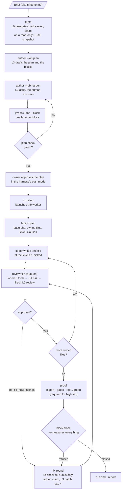
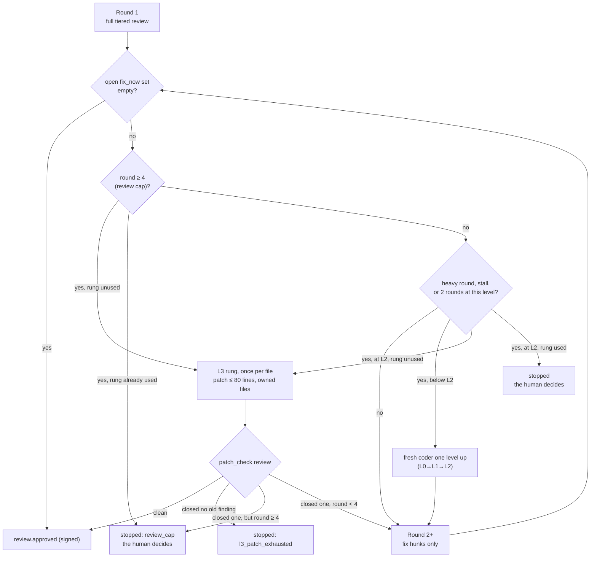

# How it works

This page follows one feature from a written brief to a closed block. The skill runs these steps
for you; every step is also a plain CLI verb you can run and inspect by hand.

The steps are:

1. Check the brief, write the plan and answer its open questions.
2. Approve the plan and start a run.
3. Open blocks, write code and review each file.
4. Run the proof and gates, close the blocks and read the report.

See [Step by step](step-by-step.md) for a guided walkthrough.

The optional Go daemon serves status and block waits; Node takes over if it is unavailable.
See [Go engine: native daemon](native-engine.md#native-daemon) for its settings and checks.

## The workflow at a glance



## Step by step

| # | Step | Command | What it produces |
|---|---|---|---|
| 1 | Facts | `code-forge facts --brief plans/<name>.md` | `plans/<name>.facts.md`: every claim tagged VERIFIED, NOT-FOUND or UNVERIFIABLE, each with the command and its output line |
| 2 | Plan | `code-forge author --job plan --brief plans/<name>.md --facts plans/<name>.facts.md` | `plans/<name>.plan.md` plus a list of questions. Refuses without a facts sheet (exit 2) or with a sheet older than the brief |
| 3 | Harden | `code-forge author --job harden --brief … --facts … --draft plans/<name>.plan.md --answers <file> --out plans/<name>.plan.md` | a new draft; repeat until no blocking question is left |
| 4 | Lanes | `code-forge jev ask lane --block B1 --plan plans/<name>.plan.md --state <file>` per block (add `--rules` without Jev) | a `decision` row with the block's lane. The plan's level for the block must match it |
| 5 | Plan check | `code-forge plan check plans/<name>.plan.md` | `plan check: ok (<n> blocks)` or one line per failing rule, exit 1; then `lanes: B1 L1 (jev) · B2 L0 (rules)` |
| 5a | Approval | under the skill: the orchestrator shows the checked plan in the harness's plan mode (Claude Code: EnterPlanMode → ExitPlanMode) | your yes. No block starts before it. A harness without a plan mode shows the plan and waits for an explicit yes |
| 6 | Run start | `code-forge run start --run <run>` | `run <run> started · engine <e> · worker pid <n>`, a per-run signing key, the review worker. With `--mode brief` (briefs, no plan; steps 1–5a are skipped) it prints `· mode brief (no plan)` and writes a signed `run.mode {mode: brief, plan: none}` row; the mode is fixed for the run, and any value other than `plan` or `brief` is a usage error (exit 2). A full brief-mode run, with an outside reviewer, related tests and worktrees: [brief-mode.md](brief-mode.md) |
| 7 | Block open | `code-forge block open B1 --run <run> --level L1 --owned <paths…> --acceptance <file> --brief <file> --lines <n>` (`--kind docs` for a docs block; `--tests <paths…>` names the block's test files for a `{test_files}` gate). In a brief-mode run `--level` may be left out: the rules pick the lane from the owned entries, `--lines` and `proof.tiers.high.paths` (a high, migration or policy/middleware path ⇒ L2; more than 4 entries or 200 lines ⇒ L1; else L0) and a signed `decision` row with `source: rules` names the block and the lane | a `dispatch` ledger row and the pointer `BRIEF <path> lines=<n> sha=<sha8> <<<EOM>>>` for the coder. Refused when an owned path overlaps another open block's. An owned path with no glob character (`*`, `?`, `{`) owns itself and every path below it: `src/feature` owns `src/feature/a.swift` (not `src/featureX/a.swift`), so it overlaps `src/feature/x.swift` or `src` in another block. A path that is a regular file when the block opens (or when `block claim` adds it) owns only itself, so `src/README` and `src/**/*.mjs` do not overlap; a path not there yet stays a possible directory. A brace entry (`src/{a,b}`) is a glob: each name owns only itself. Block open, claim, rebase, the scope and close gates, proof, the plan check and the worker all use this one rule |
| 7a | Context pack | `code-forge context pack --run <run> --block B1` (with a `context` key in the config) | `<run root>/context/B1.md` and `tokens ~<n>` (`--json`: path, tokens, lines, cut, sha256); a signed `context.pack` row when the pack is new. The orchestrator sends the file with every coder task — see [The context pack](#the-context-pack) |
| 8 | Code | the engine starts the coder with the pointer | the coder replies `ACK <sha8> lines=<n>`, then its facts diff and forecast, then code, file by file |
| 9 | Review per file | `code-forge review-file <path> --block B1 --run <run>`, then `review-file --wait <ticket>` | a verdict packet (or `status: pending` when `--max`, default 90s, passes first: wait again); a signed `review.approved` row when the file converges |
| 10 | Proof | `code-forge proof export B1 --run <run>`, `code-forge gates run --cwd <export dir>`, `code-forge proof red-green B1 --run <run> --test <file>[::<case>]` (the `::<case>` is needed only when the matched runner's argv has `{test_filter}`) | gates measured in a clean export (dependency folders linked, a Composer `vendor` copied; verified on Node and on Laravel with PHPUnit and Pest; red→green verified on Laravel with PHPUnit and Pest through `php artisan test`, on Swift, and on Xcode through `xcodebuild test` on an iOS simulator); one signed `proof` row per proven test. With `--run <run> --block B1`, a gate argv item that is exactly `{test_files}` runs only the block's tests (its `--tests`, else its owned test files), or the full suite above `gates.full_suite_threshold_files` owned files (globs and directories count the tracked and new (not ignored) files they cover; `reason: threshold`) or when none is known or no `--run/--block` is given (`reason: no_tests`); `gate.done` records `scope: related \| full` with `test_count` or the reason. A gate given as `{argv, env}` runs with those variables; code-forge shows only their names, and masks a value of 8+ characters in the gate's own output. A test that is not a `node:test` file is proven through a `proof.runners` entry (match globs, an adapter, an argv with `{test_file}`, `{test_id}`, `{test_filter}` and `{report}`): it runs the entry's argv and reads its JUnit report; the list is fixed in the run snapshot at `run start`, and the `proof` row and the JSON add `runner`, `env_keys` (the entry's env names only) and `failed_tests`, a bounded list of test names (at most 20, each cut at 200 characters, control characters removed); the full list of failed ids (`failed_ids`) is never stored. A Laravel test proves through `[php, artisan, test, "{test_file}", --filter, "{test_filter}", --log-junit, "{report}"]` with `--test <file>::<method or Pest description>`: `{test_filter}` is the case, regex-escaped, and PHPUnit and Pest read `--filter` as a regex, so a Pest description with `( ) [ ] . + ? /` is safe; a test of a class the block added is `RED_INVALID` `import`, from Laravel's plain console and from the JSON summary it prints under an AI agent |
| 10a | Progress | `code-forge status` (`--run <run>` for one run, `--json` for one line) | read-only, at most 10 lines per active run of this repository — see [Checking progress](#checking-progress) |
| 11 | Close | `code-forge block close B1 --run <run> --report <coder report>` | `block B1 closed`, or the reason it stays open. The report needs no ticket line for a file whose current bytes have a recorded review in this block and run. |
| 12 | Report | `code-forge run end --run <run>` then `code-forge report --slug <slug>` | the worker stops; 15 report sections, from `cost_per_block` to `agent_waivers`, then the spend per run and the total |

In fix rounds, the coder may use `code-forge gates run --run <r> --block <id> --changed`
for the fresh TESTS line (B99). Any green gates run with `--run` and `--block` records the
owned file hashes on `gate.done`. This includes runs without `--changed`. Without `--slug`,
these rows go to the run's project ledger. More than 200 owned files means no record.
Unreadable inputs also leave no record. The next `--changed` falls back with `no_baseline`,
unless the text-only rule below applies.

Fail fast before the gate (B392). `code-forge block ready <id> --run <r> --preflight` needs no
gate result and runs in about a second. It lists every close blocker that a gate cannot fix, in
one list: `stale_base` (the block's base branch moved past its recorded base; the detail names
the branch tip sha, the fix is `code-forge block rebase <id> --run <r> --accept-landed`), open
review findings on the current content (`not_approved`, `late_unruled`,
`autopilot_waiver_invalid`), `rule_break` (ledger rows and the transcript scan) and, with
`--report`, `coder_report_failed` (missing review ticket ids, a failed TESTS line). A file with
no review yet is not a preflight blocker, because review runs in parallel with the gate. A check
it cannot decide in Go (for example a transcript that needs the Node rule scan) is printed as
`skipped <check>: <why>` (`skipped` in `--json`), never as a blocker. It exits 0 with
`block <id> preflight clean`, or 1 with the list; `--json` prints one line
`{block, preflight: true, ready, blockers, skipped}`. There is no docs lint in `block ready`.
`gates run --run <r> --block <id>` in Go runs the same preflight first, by default: a blocker
stops it with exit 1, one stderr line per blocker ending in `no gate was run; fix: <fix>`, and
no gate command starts. `--no-preflight` skips it; `--preflight` asks for it explicitly. With
`--auto-rebase` or `--allow-stale-base` the stale base keeps its B363 handling below and the
preflight checks the rest.

`{test_files}` expands to changed tests and stem-paired tests of changed sources.
`{changed_files}` expands to changed lint/format paths. Deleted files count for pairing and
the threshold. Both tokens receive only files that exist now. Each token must be a whole
argv item. It cannot be the command or the only item. Config validation checks these rules.
Without `--changed`, `{changed_files}` is dropped. Outside the text-only rule below, gates
without tokens run as before.

Rows carry `scope: changed`. Fallback rows also carry a reason. The fallback reasons
`no_baseline`, `unpaired`, `threshold` and `no_changes` apply only to `--changed` without
`--run` and `--block` (the plain path); they never apply to
`gates run --run <r> --block <id> --changed`, which uses the Go selection below:

- `no_baseline` uses the normal block scope.
- `unpaired` uses the normal test scope when a changed source has no test pair.
- `threshold` runs the full suite above `gates.full_suite_threshold_files` changed files.
- `no_changes` uses the normal block scope when nothing is left to run.
- `go_only` and `import_graph` are the Go selection below (B399b, B404).

The Go engine (`gates run --run <r> --block <id> --changed`) never runs the full suite and
never hands `--changed` over to Node (B404). A test command with `{test_files}` gets the
selected files there; a test command without `{test_files}` gets them appended as its last
arguments, so it never runs unscoped. Go runs it once with, in this order and without
duplicates:

1. the block's `--tests` entries, its owned and changed tests, and the stem-paired tests of
   its changed sources;
2. for a change under `native/` or to `scripts/build-native.mjs`: `test/compat/go.test.mjs`
   (it runs `go build`, `go vet` and `go test ./...`) and the compat tests named after the
   changed Go files (see below);
3. for a change to a native build input (a `native/` Go file other than `*_test.go`,
   `native/go.mod`, `native/go.sum` or `scripts/build-native.mjs`): every other test that
   builds or runs the native binary, found by its text (`code-forge-native`,
   `cmd/code-forge-native`, `build-native.mjs`, `go-binary.mjs`) or by a `test/` helper it
   imports (B330);
4. every test that imports a changed file, directly or through other files: static
   `import`/`export from`, literal `import()` and `require()`, `new URL('..', import.meta.url)`
   (a directory URL covers the files under it), and a file that names a path in the closure
   by its repository path (a test that spawns `scripts/s.mjs` reaches what that script
   imports). An import of a deleted or renamed changed file still counts. The CLI entry
   `bin/code-forge.mjs` counts as importing every `src/cli/*.mjs` (its router loads them by
   readdir) and the launcher `bin/code-forge` as importing the entry, so a test that spawns
   either reaches every verb module (B373c). The graph is narrow (B427):
   - comments make no edge: a path named in a comment or a JSDoc `import()` type is not read;
     a path named in a `src/` file is data, not an edge;
   - named imports are followed through re-export barrels (`export { a } from`,
     `export * from`): an importer reaches a changed file only through the bindings it imports
     from it. A namespace, side-effect, dynamic or `require()` import uses the whole module;
   - inside an ES module only the exports whose code reaches a changed binding carry the
     change on. Code that runs when the module loads (an initializer with a call, a class, an
     expression statement), CommonJS and a module it cannot split carry it to every importer;
   - `gates.import_graph.stop` lists hub files (paths, `dir/` prefixes or globs) where the
     closure stops: the tests and test helpers that import or name a stop file are selected,
     the product files that import it are not, unless the stop file itself changed. It is empty
     by default; this repository stops at the hubs measured on the B362b+B402 batch
     (`src/session/spawn.mjs`, `src/config/validate.mjs`, `src/worker/loop.mjs`,
     `src/context/pack.mjs`, `src/cli/block.mjs`), which took that batch from 348 of 380 tests
     to 65;
5. `test/compat/config-golden.test.mjs` for a change under `test/fixtures/`, `schema/`,
   `scripts/compat-golden.mjs` or `src/config/` (B409).

Only test files run: a file whose name marks a test (`*.test.*`, `*.spec.*`, `*_test.go`,
`*Test.php`, `test_*.py`, `*_test.py`, `*Tests.swift`). A changed helper, fixture or script under
`test/` (`test/helpers/x.mjs`, `test/helpers/run-suite.sh`) is never run itself and is never a
stem-paired test; it selects, through step 4, the tests that import it or name it by its
repository path (B394).

Tests of any language count, including the stem-paired tests of changed sources (Node's
pairing: `FooTests.swift` for `Foo.swift`, `test_foo.py` for `foo.py`). A selected test that
the test runner cannot take (a PHP test under `node`, for example) is dropped; it never widens
the gate. When nothing is selected, the test gate is skipped and the command never
starts. The result and `gate.done` carry `scope: related`, `test_count` and, on `gate.done`,
`test_files`, with `reason: go_only` for a block with no Node product file and
`reason: import_graph` otherwise. A text-only skip still wins.

A block is Go-only when every owned path is under `native/`, `docs/`, `plans/` or
`.github/`, is a runnable test file under `test/` (`*.test.*` or `*.spec.*`), is
`CHANGELOG.md` or another `*.md` file, or is `scripts/build-native.mjs`. A Node product
file is any path under `src/` or `bin/`, a `scripts/` `.mjs` file other than
`scripts/build-native.mjs`, `package.json` or `package-lock.json`.

For the compat tests named after a Go file: for
`native/cmd/code-forge-native/a_b_c.go` the names tried are `a-b-c`, then `a-b`, then `a`; the
longest one that matches wins. A compat test `test/compat/[parity-]<name>.test.mjs` matches when
`<name>` is that key or starts with key plus `-`. A file under `native/<package>/` tries the
package name. So `status_direct.go` adds `parity-status-direct`, `status.go` adds
`parity-status` and `parity-status-direct`, and `native/daemon/` adds `daemon`. A file with no
match adds nothing.

`code-forge gates run --run <r> --block <id> --full` is the only way to run a block's full
suite locally: it runs the whole test command with no file list, and the gate carries
`scope: full` and `reason: explicit`. Plain `code-forge gates run` with no `--run` and no
`--block` is the other full-scope path; no block gate or land gate ever runs it. `--full` cannot go with `--changed` (exit 2) and needs `--run` and
`--block`. The full suite otherwise runs in CI.

The orchestrator runs full gates before `block close` (D2).

To overlap reviews with coding, set `review.file_loop: overlap` (`wait` is the default; `watch` uses the commit loop below). Enqueue each green file with `code-forge review-file <path> --block <id> --run <r>` and continue coding. Before the completion sentinel, including in fix rounds, run `code-forge review-file --wait-block <id> --run <r> [--max 90s]`. It reads the workspace scope mirror, the queue and owned changed files; it never runs a review itself. It prints one JSON line `{block, files: [{file, ticket, status, outcome}], done}` with `done`, `findings`, `pending` or `not_queued` per file. Changed content with an earlier ticket gets a new current-content ticket after any unseen findings are delivered; the worker marks an old pending ticket stale at start. Timeout returns exit 0 with `done: false`, `reason: wait_timeout`; wait again. No live worker for the run returns exit 3 with `status: worker_down`, always `done: false`, even with completed markers; print the FAILED sentinel. An unreadable scope, ticket or completion marker refuses (exit 1). `done: true` means reviews finished or findings were delivered, not approved: inspect the tickets with `--wait` and fix findings. The close still checks signed approvals independently.

Each file's `outcome` is `approved`, `findings`, `stopped`, `split_required` or `unavailable` from its completion marker, and `null` while `pending` or `not_queued`; a live join queues an owned changed file even if it has no earlier ticket. A `split_required` outcome returns `done: false`, `reason: split_required` and `next` naming the file: the owner raises `review.budgets`, runs `run reload`, then runs `review-file <path> --fresh`.

When a stopped review has findings and the file's current content in the block tree differs
from the stopped review's hash, the join automatically queues a fresh full review at round 1.
It uses the same ticket path as an explicit reopen, writes a signed `review.reopened` row with
`by: auto` and reason `auto-requeue: content changed after stopped review`, and prints one
`auto-requeue <file>: … (ticket <id>)` line on stderr before waiting for the new ticket.
Repeated joins reuse that attempt. A signed review after the automatic restart clears earlier
cap findings; its own findings still count. Unchanged content, fully waived findings, and a file owned
by another open block do not trigger a restart. A waiver of old findings still cannot approve
new bytes. `block land` uses this join before its gates and close. Direct `block close`
also queues changed stopped findings and waits for their new tickets before checking reviews.

`review.exclude` skips generated lock files, including those in scaffolding archives, at any depth by default. A project list replaces the defaults; `[]` disables exclusions. Its repo-relative globs use the ownership matcher (`*`, `?`, `**`, `{a,b}`). Watch and enqueue skip matching files; `review-file <file>` prints `not reviewed (review.exclude <rule>): <file>` and exits 0 without a ticket. The block join lists them with status `excluded` and can finish without their reviews. Ownership, proof and every other close check still apply.

For excluded `package-lock.json` and `npm-shrinkwrap.json`, close parses the JSON and requires every `packages.*.resolved` URL to use HTTPS on a host in `review.lockfile_registries` (default `["registry.npmjs.org"]`), with nonempty `integrity` on each resolved package. Entries with `link: true` or no `resolved` are allowed. Invalid locks refuse `lockfile <file>: <detail>`. Other lock formats receive no safety check. A passing close prints the same `not reviewed` line and writes one signed `gate.review_excluded {block, file, content_hash, rule}` row per excluded file; refused closes write none.

With `review.file_loop: watch` (B104), commit each owned file after its tests are green and continue coding. Watch replaces per-file enqueueing. Before the completion sentinel, including fix rounds, run `code-forge review-file --wait-block <id> --run <r> [--max 90s]`, inspect finished tickets with `--wait <ticket>`, and fix findings. The worker watches the block worktree HEAD (otherwise repository HEAD) and reads owned content from git objects. Watch waits until a later tick sees the same HEAD after 15 seconds of quiet, or 120 seconds since the burst's first unqueued HEAD, then processes only the current HEAD with the same ticket ids as manual requests. Later commits of a file that already has a ticket of this block are held until `--wait-block`. If the last review found problems and the file changed blind, the join does not recheck it. It answers `status: findings` with that ticket and records delivery once. Read the findings with `review-file --wait <ticket>`, fix them, and the next join rechecks the latest content once. A file whose last review approved still queues its latest content at the join. A stopped file with changed content and unwaived findings restarts automatically as described above. Each held file writes one `watch.held {block, file, content_hash}` row per processed head. Older pending tickets are still marked `refused`, `reason: superseded`. A running ticket finishes for its old hash, which cannot approve newer bytes; `--wait-block` joins the current ticket per file. The join reruns a stale, unavailable or round-1 `split_required` review of the current content once. The file stays `pending` until that rerun finishes. No manual `--fresh` is needed. The retry is recorded per ticket across joins. If the rerun is stale again, later joins report `done`; `--wait <ticket>` shows that stale status. `--fresh` refuses a superseded marker; enqueueing that content again removes only its superseded marker so it can run, while a real result stays cached. `queue/watch/<block>.json` stores the last queued commit and pending HEAD; missing or unreadable state restarts at `base_sha` with idempotent tickets. A rewound tick queues nothing and drops the last queued and pending commits so the next tick restarts at `base_sha`. A `watch.skipped {block, reason}` row is written once per reason until a healthy head clears the skip reasons: `unreadable_head` (head, tree or objects cannot be read), `not_descendant` (head does not descend from the block base), `rewound` (head no longer descends from the pending or last queued commit), or `unowned_path` (unowned paths are ignored; owned paths still queue). A skip never fails the block. After a `watch.skipped` row, use `code-forge review-file <path> --block <id> --run <r>` when the file needs a manual review; use `code-forge review-file <fix file> --block <id> --run <r> --answers <ids> --of <source>` for a fix in another owned file that answers findings. Set watch before starting the worker. Without the `review.file_loop: watch` setting, the default `wait` loop performs no watch work or git calls.

The coder's turn ends with `===BLOCK <id> COMPLETE===` or `===BLOCK <id> FAILED: <reason>===`.
Nothing else counts as completion. The final report needs no `reviewed <path> ticket <id>` lines:
`block close` prints one for every file the review gate accepts (approved, waived or answered),
with the queue's ticket. The close prints the reviewed lines, then the `reviewed_by_waiver` lines,
then the `closed` line. With `--report`, a hand line that names another ticket prints
`WARN report ticket mismatch <path>` on stderr when the block closes, and the close goes on. A file
with a `review.waived` finding still gets a line; only a close with every review waived
(`--no-require-reviews`) or `review.external` prints none. The printed line has no `via`: `--json`
and the block's done file carry the lines as `reviewed: [{file, ticket, via}]`, with
`via: approved` for a file with a signed approval, `via: waiver` when at least one of its open
findings was waived (also when the others were answered), and `via: answered` when every one was
answered.

Two cases give a file the gate accepts no line. A file the gate accepts gets no line when the queue
cannot give its ticket (its content changed after the gate read it, or its path cannot be
resolved): the close prints `WARN no ticket for <path>`, or `WARN bad ticket for <path>` when the
ticket is not 24 lowercase hex characters. If the lines cannot be built at all, the close still goes
on, with no line and one `WARN reviewed lines unavailable: <message>`. Like the mismatch WARN, these
go to stderr and print only when the block closes; a refused close prints none of them. The close
refuses `coder report FAILED: no review-file ticket id for <files>` only when, under `--report`, a
file the review gate accepts has no reviewed line from the close and no hand line for it in the
report.

`block ready` and `block close` find review tickets by themselves (B405). Under `--report`, a
changed file with no `reviewed <path> ticket <id>` line, no reviewed line from the close and no
signed approval is credited by the latest done review-file ticket of the same run, block and file
whose content hash equals the file's current content: a queue ticket with a `.done` marker for a
real review (not stale, unavailable or refused). A ticket for older content, another block, or one
not done yet credits nothing, and the check still says
`coder report FAILED: no review-file ticket id for <files>`. Report ticket lines stay optional and
are still accepted. This credit only satisfies the report check; the review gate still decides
whether the current content is approved.

Block land gates run the Go selection above, through `{test_files}` or appended to a test
command without it. The suite wrapper keeps its sandbox and both leak checks for scoped runs.
The full suite runs in CI, or locally only with `gates run --run <r> --block <id> --full` or
with plain `code-forge gates run` (no run and no block).

`gates.extra.invariants` is refused. Earlier versions accepted it, but no engine ran its
script, so the check was skipped without a word. Config validation now rejects the key as
unknown, and `gates run` (with or without `--run`/`--block`, and inside `block land`) exits 2
before any gate runs, with one line: `gates.extra.invariants is not supported`. To run such a
script as a gate, add it to `gates.custom` as `{name, argv}` (B402).

### Block help

Every `block <verb>` accepts `--help` or `-h`, prints that verb's usage and exits 0 without
reading run state, prompting or writing anything, even when other required arguments are absent.

### Block acceptance and dependencies

For `block open` and `block amend-acceptance`, `--acceptance <file>` reads a JSON/YAML list of
`{clause, tests}` objects. `tests` is a nonempty list of test ids, for example:

```yaml
- clause: The command prints its usage and exits successfully
  tests: [test/cli/verb-help.test.mjs]
```

The equivalent JSON is `[{"clause":"The command prints its usage and exits successfully","tests":["test/cli/verb-help.test.mjs"]}]`.
Device checks may instead use `{clause, kind: human_check}` without `tests`.
For `block open`, `--brief <file>` must name a file inside the repository; it cannot be inline
brief text or a file outside the repo.

The human can correct an open block's snapshotted clauses with `code-forge block amend-acceptance <id> --run <r> --acceptance <file> --reason <text>`. Both terminals and confirmation are required; there is no `--yes`, and an active autopilot grant refuses it. The file follows the same rules as `block open`; invalid or unchanged lists write nothing. One signed `block.acceptance_amended` row records the old and new hashes and the reason. Earlier reviews no longer count, and the next review request or watch tick reviews the new clauses. Coders never run this verb.

UI acceptance may include `kind: human_check` clauses without tests, recorded as `human_checks`. After all code gates pass, `block close` leaves such a block `awaiting_human_check`, prints every check and the next command, and delays its done signal. Status and report list the waiting ids, and `run end` refuses until the human checks the device and types `code-forge block human-pass <id> --run <r> --note "<device check note>" [--proof <existing-path>]` in a terminal, or stops the block. The note is required; `--proof` is optional, and when it is given the path must exist. When omitted, the row records `proof: null`. Human pass records a signed human row and closes it; there is no `--yes`, and an active autopilot grant refuses the verb.

For design first, give the design block an acceptance clause such as `{clause: "Owner approves the design", kind: human_check}`. Open it, finish its work and pass its code gates, then close it. The owner approves in their terminal before code blocks open:

```sh
code-forge block open DESIGN --run <r> --level L1 --kind docs --owned docs/design.md --acceptance design.acc.yml
# Finish the design and pass its code gates, then:
code-forge block close DESIGN --run <r>
# The owner checks the design and runs this in their terminal:
code-forge block human-pass DESIGN --run <r> --note "Design approved"
code-forge block open CODE --run <r> --level L2 --owned src/feature.mjs --acceptance code.acc.yml --after DESIGN
```

`--after <id> [<id> ...]` requires every named block in the same run to be `closed`. Under the run lock, open refuses with `after-not-done`, naming every blocker and its status (`open`, `awaiting_human_check`, `stopped`, or `not in run`), and creates no rows or worktree. With `--json`, it also prints `{block, event: "refused", code: "after-not-done", message}`. Naming the new block itself refuses with `bad-after`; duplicate ids are removed. The entry and `dispatch` row record `after: [ids]` only when supplied. A later attempt checks dependencies again only if that call supplies `--after`.

`--after-outcome <step> [<step> ...]` waits for pipeline step outcomes in the run's project root (the main checkout, never the block worktree). Each outcome must exist, have status `approved`, and pass `outcome check`. The flag is repeatable; duplicate step ids are removed. Missing or invalid pipelines and unknown step ids refuse with `bad-after-outcome`; an outcome that is not ready refuses with `outcome-not-ready`, naming the step and first problem. Both refusals exit 1 and create no rows or worktree. With `--json`, stdout is `{block, event: "refused", code, message}`. On success, the entry and `dispatch` row record `after_outcome: [{step, sha256}]`, hashing the accepted outcome file's bytes. With both dependency flags, `--after` is checked first and both must pass. See [pipelines.md](pipelines.md) for an example.

### Small blocks and proof

Small changes can use `block open <id> --kind light`. A light block may change at most `light.max_files` owned files (default 5) and `light.max_lines` added plus removed lines (default 300). Its reviews go in one batch, and its gate runs only the block tests (`{test_files}` in the test command). If close refuses with `light-limits`, stop the attempt and open the same id again with `--kind code --attempt <n+1>`.

Red→green: each new or changed test must FAIL on the old code first (red), then PASS on the new code (green). A red caused by an import, compile or crash error proves nothing; the red must be an assertion failure.

The run lock is a directory next to the run record (`<run>.lock`), shared by the Go and Node verbs, with a 5 s wait. A Go verb writes `owner.json` (pid, process start token, verb) inside it while it holds the lock and removes both on release. A Go verb that waits on a lock whose owner process is gone (or whose pid now belongs to another process) breaks it once, prints `code-forge: broke stale run lock (pid N)` on stderr and takes it; a lock with no owner file (an older binary or a Node holder) is broken only when it is older than 10 minutes. A lock whose owner is alive is never broken. So a verb that crashes while holding the lock no longer blocks every later verb (B423).

### Checking progress

`code-forge status` (B64a) is how the orchestrator checks progress, instead of reading logs or
polling the coder's transcript. It is read-only: it writes no ledger row and no file beyond the
breadcrumb every verb writes, and it never takes the run lock, so it never blocks a worker or a
block verb (nor waits on them). It shows every run that is not ended whose workspace is the
current repository, newest first, with one blank line between runs, in at most 10 lines per run.
A run with ten open blocks, two closed and one stopped:

```
run <run> · active · plan · spent $1.20+? of $5.00
B1 open L1 · openai/<model> · gate timeout (test) · findings 1
B2 attempt-2 L2 · - · gate pass · findings 0
B3 open L1 · - · gate none · findings 0
B4 open L1 · - · gate none · findings 0
B5 open L0 · - · gate none · findings 0
B6 open L1 · - · gate none · findings 0
B7 open L1 · - · gate none · findings 0
… +3 more blocks
closed 2 · stopped 1
```

- **Line 1**: the run, its status, its mode (`plan` or `brief`) and the spend: `run status`'s
  spent_usd with 2 decimals, followed by `+?` when at least one session has no known price (its
  cost is not in the sum), or `$?` alone when the ledger cannot be read. ` of $<budget>` shows
  only with `budget.usd` set.
- **One line per open or in-attempt block**, in block id order: its state (`open`, or
  `attempt-<n>`), its level, the model of its latest coder session row (`-` when the ledger names
  none), its last gate run and its open findings — the number of review findings the close gate
  (`checkBlockReviews`) would refuse today. The gate field is printed as `gate pass`, `gate fail
  (<gate>)` (the failing gate named by the last `gate.red` of that run), `gate timeout (<gate>)`
  (that gate exceeded its time limit; rerun with a higher timeout), `gate fail` (a failed run
  with no named gate) or `gate none` (no gate ran yet).
- **`… +<k> more blocks`** is the last block line when the blocks do not fit.
- **`closed <a> · stopped <b>`** shows only when either is non-zero. It is printed LAST, but it
  keeps its place in the 10-line cap ahead of block lines: when the lines do not fit, block lines
  are dropped first, never this one.

With no such run it prints `no active run` (exit 0). `--run <run>` shows that run, even ended; an
unknown run exits 1 (`status: no run record for <run>`), and a usage error (an unknown flag, an
argument) exits 2. `--json` prints exactly one line, `{"runs":[{run_id, status, mode, spent_usd,
unknown_usd_sessions, budget_usd, blocks: [{id, state, level, model, gate: {result, name},
findings}], more, closed, stopped}]}`, with every open block (no cap) and `more` always 0;
`gate.result` is `pass`, `fail` or `none`, and `gate.name` is the failing gate's name, or null for
`pass`, for `none` and for a fail with no named gate; `spent_usd` and `unknown_usd_sessions` are
null when the ledger cannot be read. Transcript and diff text are never printed.

Every block verb also takes `--json`. On success stdout is exactly one line,
`{"block":<id>,"event":<event>,…}`:

| Verb | `event` | Other fields |
|---|---|---|
| `open` | `open` | `level`, `asked`, `source` (`flag`, `rules` or `autopilot`), `kind`, `attempt`, `base_sha` (full), `tests` (count), `worktree` (`{path, branch, reused}` or null), `brief` (the pointer or null) |
| `attempt` | `attempt` | `attempt` |
| `rebase` | `rebased` | `old_base`, `new_base` |
| `claim` | `claimed` | `path` |
| `close` | `closed` | `status`, `reason`, `close_event` (or null); when a file passed as reviewed by waiver also `reviewed_by_waiver` (`[{file, content_hash, status, findings, by}]`); with `--remove-worktree` also `worktree` (`{removed, path, branch}`; a block with no worktree refuses `--remove-worktree` as a usage error, exit 2); with `hooks.on_block_end` set also `done_file` when the close ended the block (closed or stopped) — see [When a block ends](#when-a-block-ends-the-done-file-and-the-hook) |
| `stop` | `stopped` | none; with `hooks.on_block_end` set, `done_file` |
| `waive` | `waived` | `finding`, `file`, `by` |

On failure the exit code and stderr are unchanged and stdout stays empty, except a close the gate
refused, which also prints `{"block":<id>,"ok":false,"reason":<text>}`; every other close refusal
(a usage error, a block not open, a cancelled `--no-require-reviews`, a failed worktree removal)
leaves stdout empty. Without `--json` the output
is byte-identical to before.

### When a block ends: the done file and the hook

A block ends when `block close` closes it, when `block close` stops it (a pin event or
`ledger.tamper`), or with `block stop` (B64b). Every end writes `<run root>/blocks/<id>.done.json`
— the run root here is the run's state folder, `~/.code-forge/runs/<run>/`, next to the run record
(never the temp folder that holds the context packs) — after the end's ledger rows, atomically (a
temp file in the same folder, then a rename); a later end of the same block overwrites it. Its
absolute path is in the hook's `CODE_FORGE_DONE_FILE` and in `done_file` of `close --json` and
`stop --json` (with the hook set). A close:

```json
{"block":"B1","run_id":"r1","status":"closed","event":"block.close","reason":null,"commit":"<sha>","spent_usd":1.25,"unknown_usd_sessions":0,"findings":0,"at":"<iso time>"}
```

A `block stop`:

```json
{"block":"B2","run_id":"r1","status":"stopped","event":"block.stop","reason":"not needed","commit":"<sha>","spent_usd":0.25,"unknown_usd_sessions":1,"findings":1,"at":"<iso time>"}
```

- `status` is `closed` or `stopped`.
- `event` is `block.close` for a close that closed the block, `block.stop` for `block stop`, and
  the close's own event (`worker.replaced`, `ledger.tamper`, …) for a close that stopped it.
- `reason` is null for a plain close; otherwise the stop reason, redacted.
- `commit` is HEAD of the block's worktree, else of the repository; null when it cannot be read.
- `spent_usd` and `unknown_usd_sessions` come from the block's own ledger rows, computed as
  `code-forge status` does; both null when the ledger cannot be read.
- `findings` is the count of open review findings, as `code-forge status` counts them; null when
  the ledger cannot be read or the count fails.

The file never holds transcript text, diff text or secrets. If it cannot be written, the result,
exit code and stdout stay the same (with the hook set, `done_file` is then null) and stderr adds
`warning: done file not written: <reason>`.

The owner can also set a command that runs at every block end:

```yaml
hooks:
  on_block_end:
    argv: [osascript, -e, 'display notification "block done"']
    timeout_s: 60     # 1–600, default 60
```

It is read from the run's config snapshot and fixed for the run (`run reload` refuses a change).
It runs once per end, after the done file and outside the run lock: no shell, cwd = the repository
top level, stdin closed, output discarded, and its process group killed at `timeout_s`. Its env adds
`CODE_FORGE_RUN`, `CODE_FORGE_BLOCK`, `CODE_FORGE_BLOCK_STATUS` and `CODE_FORGE_DONE_FILE` (the
empty string when the done file was not written). It runs even when a later step of the verb
(`--remove-worktree`) fails. One signed
`hook.ran {block, hook, argv0, exit, signal, timed_out, duration_ms}` row per block end records it,
also when the hook fails, times out or is not found (`argv0` is the basename only; `exit` is null
unless the hook exited; `signal` names the killing signal, `SIGKILL` on a timeout, else null).
A hook that does not exit 0 only warns, in one of these forms:
`warning: on_block_end hook exit N`, `… timed out`, `… not found` (argv[0] does not exist),
`… signal <NAME>`, or `… failed to start (<error code>)` (any other spawn error, a missing
repository folder included). If the `hook.ran` row itself cannot be written, stderr adds one more
line, `warning: on_block_end hook row not written (<error code>)` — an error code only, never
message text. With the hook set, `close --json` and `stop --json` add `done_file`
(the absolute path, or null when it was not written); without it, nothing changes (no hook, no row,
the same output). The hook runs outside coders. `.code-forge.yml` is non-ownable (the same
guard as `review.external.required`) with the hook set — also when `hooks.on_block_end` is the
only key that guards it — and the close gate flags a coder transcript line that runs the hook (its
argv[0] basename plus argv[1] when present and not blank, both trimmed; argv[1] is one literal
token even with spaces inside, so such an argv[1] never matches a transcript line, which is split
on spaces) as `rule_break … code-forge-on-block-end-hook`. The orchestrator waits for the done file or the hook
instead of polling. A done file from an earlier end of the same block stays after a reopen, so it
counts only when its `at` is later than the current dispatch; if no fresh done file appears by the
time the coder agent reports, the orchestrator runs `code-forge status` once.

### The context pack

With a top-level `context` key in `.code-forge.yml` (B63a), every coder task carries the same
project rules, lessons and commands:

```yaml
context:
  rules: [CLAUDE.md, docs/conventions.md]   # paths relative to the repository root, in order
  lessons: docs/lessons.md                  # one file
  commands:                                 # argv lists, each optional; never run by code-forge
    build: [npm, run, build]
    test: [npm, test]
    lint: [npm, run, lint]
    format: [npm, run, format]
  max_lines: 300                            # default 300, at least 20
```

`code-forge context pack --run <run> --block <id>` writes `<run root>/context/<id>.md`:

- a header: run, block, level, owned files, test files (from `--tests`) and, for a worktree
  block, its path and branch;
- the commands, as argv text in POSIX shell quoting (a token with anything but letters, digits
  and `_@%+=:,./-` is single-quoted, an embedded `'` written `'\''`, and an empty token shown as
  `''` — though the config refuses an empty token), so a pasted line expands nothing; each line
  goes through the same secret redaction as the rules and lessons. A control character (a newline
  included) in a token, a rules or lessons path, or an owned or test file name is refused ("contains
  a control character"), so no value can forge a line of the pack;
- each rules file, then the lessons file, each headed by its path (an empty or whitespace-only file
  gives its heading alone).

Over `max_lines` the lessons are cut first, then the rules files from the last one backwards; each
cut section ends in `[cut: N lines dropped]`. The header and the commands are never cut. It prints
the path and `tokens ~<n>` (bytes / 4, as for review packets), or with `--json` one line
`{"path":…,"tokens":…,"lines":…,"cut":…,"sha256":…}`. A new pack writes a signed `context.pack`
row with the fields `{block, path, sha256, tokens, lines, cut}`. A second pack with the same
content writes no row and prints the same output: the check is against the block's last
`context.pack` row (same sha256 and path). The ledger is read before anything is written. The new
text goes to a temp file, the row is appended, and only then is the file renamed into place: a row
that cannot be appended removes the temp file and leaves an earlier pack as it was (exit 1,
"nothing was written"); a rename that fails after the row says the row was already written.

Coders may run `context pack` themselves; `.code-forge.yml` stays non-ownable, so a coder cannot
change what goes into it.

Rules and lessons are always read from the main tree, never from a block worktree. A missing file,
an absolute path, a `..` segment or a symlink that leads out of the repository is refused (exit 1,
naming the key and the path; a broken symlink is judged by where it points: outside is refused as
outside, inside as missing), and so is a config without `context` or with a bad `context` value;
nothing is written then. A file name that merely starts with `..` (`..notes.md`) is inside.

The review packets carry the same rules and lessons in their project-rules slot (at most 60 lines,
the rules first, then `### lessons`, trimmed together under that one cap), read from the main tree
when the ticket is reviewed. A rules or lessons file that is missing, outside the repository or
unreadable at that moment makes the ticket `unavailable` with `reason: context-unreadable` (see
the review results below). Without a `context` key the packets are exactly as before.

`context` is not authority: code-forge reads the live config for it, not the copy fixed at
`run start`, and `run reload` accepts a change to it (the next review ticket uses it; the next
`context pack` reads the live config directly). The pack's run root still comes from the run's own
snapshot (`tmp.root` is fixed for the run).

### One worktree per block

With `proof.isolation: worktree` (B62a), each block gets its own git worktree on its own branch.
`block open` runs `git worktree add <dir>/<block> -b <branch> <base>` before the block is recorded:

- The tree goes in `proof.worktree.dir`, resolved from the repository top level. The default is
  `../<repo-name>-worktrees.noindex` on macOS and `../<repo-name>-worktrees` elsewhere, beside the
  repository; `<repo-name>` is replaced with the basename of the repository top level. Spotlight
  skips the `.noindex` directory. First use of the macOS default creates a missing
  `.metadata_never_index` marker without overwriting one. Other platforms, explicit directories,
  and retained old directories are unchanged.
- The branch is `proof.worktree.branch`, default `forge/{run}/{block}`. Only `{run}` and `{block}`
  are filled in, and git must accept the name.
- The tree starts from `proof.worktree.base`, else the block's base.

An existing run with worktrees in the old default directory keeps using it for new blocks;
each block keeps its recorded path. To migrate, finish or end the runs, then
`mv ../<repo-name>-worktrees ../<repo-name>-worktrees.noindex`, or remove the old folder when no
longer needed. Never move live worktrees. macOS `doctor` warns about an effective worktree
directory outside `.noindex`. Temp packets stay in `$TMPDIR/code-forge/…`: the default macOS
`$TMPDIR` under `/private/var/folders` is already excluded from Spotlight indexing.

The block records `worktree {path, branch, base_sha}`, and a signed `worktree.created` row comes
before `dispatch`. The open prints `worktree <path> · branch <branch>`. If the tree cannot be made, the
open is refused and nothing is recorded:
- the branch already exists (checked again just before the tree is made, so a branch made in
  between is refused, never deleted),
- something is already at the path,
- the base is not a commit,
- the name or the block id is invalid, or
- `git worktree add` fails (a branch it made is deleted again).

If the open fails after the tree was made, the tree and the branch it made are removed again.

A re-open with `--attempt` reuses the same tree and branch, and the block keeps the tree's base; a
`--base` naming another commit is refused. For an open worktree block, `block rebase <id> --run <run>`
rebases its branch onto its recorded base branch's head and updates both recorded bases. Commit or
clean the tree first. The rebase replays first and refuses only a real conflict (B431): when main
changed owned files, the block's commits are still replayed onto the new head. On a clean replay the
base moves, the signed `block.rebase` row lists those files as `upstream_owned`, the plain output adds
`upstream_owned: <files>` and each changed owned file is queued for review again; no human verb is
needed. A real conflict (main and the block changed the same lines) restores the old head and refuses
with one line, `rebase-conflict: block <id>: replay conflicts in: <files>; nothing changed: …`; rebase
the block worktree onto its base branch by hand (`git rebase <branch>`), resolve those files, then
run `block rebase` again: the block's commits then replay cleanly. `CHANGELOG.md` has one extra rule: when
main and the block only added lines (none removed or changed), the replay keeps both, main's lines
first; a removed or changed line in the conflicted region stays a `rebase-conflict`. A repository
`.gitattributes` with `CHANGELOG.md merge=union` does not bring back a line the block removed: the
replay turns git's union driver off and keeps union only for other files marked `merge=union`. The
same rules apply to `review-file --rebase-check`, `block rebase --accept-landed` (a commit outside
the run's closed blocks is named `upstream_owned` instead of refused) and the rebase of each block in
a batch `block land`. Run the gates again after rebasing: earlier green rows no
longer satisfy close. A block without a recorded base branch cannot rebase. A tree that is gone (removed,
or its directory deleted by hand) is added back at the same path on the same branch; a tree left on
another branch or a detached HEAD refuses the re-open.

In a worktree of code-forge itself (a tree with `native/go.mod` and `scripts/build-native.mjs`), a
`block rebase` that moves the tree's HEAD across a change to `native/**` or `scripts/build-native.mjs`
then rebuilds the tree's native binary with `node scripts/build-native.mjs --host` (B408), because the
Node compat tests run that binary. A failed build exits 1 with one line naming `native-rebuild-failed`;
the rebase stands, and the line gives the command to rebuild by hand.

`block open <id> --attempt N` (N > 1) restores paths from the block's earlier signed
`block claim` rows alongside `--owned`. `block attempt` keeps those claims too. Both print
`kept claims: <n>`; a retry does not require claiming those paths again.

Two open blocks that each have a worktree, at different paths, may own the same path. A block without one is checked
against every other open block as before. `block close <id> --run <run> --remove-worktree` removes
the tree after a successful close with `git worktree remove` (never `--force`) and keeps the branch.
It writes a signed `worktree.removed` row. A tree whose directory was already deleted by hand
refuses the close itself (see below). A tree with uncommitted or untracked files stays where it
is, with a `worktree.remove_failed` row and exit 1, and the block stays closed. Without the flag the
tree stays. Coders may not use the flag. code-forge pushes only when `block land` is told to
(`--push` or `land.push`, below), and never deletes a branch except one a failed open made itself.

`code-forge block land <id> --run <run> --report <file> --transcript <file> [--max <dur>] [--merge] [--no-merge-gate] [--push] [--watch-ci] [--json]`
joins the block's reviews and, at the same time, runs `gates run --run <run> --block <id> --changed`
in its recorded worktree. When the tree changes during the join, the gates run again. Land closes
only when the join is clean and the gates pass. When both fail, one stop message names both.
A finding or a gate timeout stops the gate process group, and land never closes or merges.
Then it runs the normal close checks with the report and transcript. It stops at the first
failure with exit 1, the step, findings or gate output or close refusal, and the next command.
A close awaiting a human check also stops before merging. Each land, pass or stop, writes one
signed `land.timing` row with `join_ms`, `gates_ms` and `merge_gate_ms` (null without a merge
gate). A reused merge gate also records `merge_gate_reused: true` and the full tree id in
`merge_gate_tree`. Per-gate times stay in `gate.done`.

`--max` sets the total review wait, defaulting to `30m` (also accepts `90s` or `1500ms`).
Land makes up to three join attempts while a held findings round remains open, sharing that
deadline across attempts. Completed findings stop the land. When the wait expires, land stops
at `join` with `wait_timeout` and a `next:` land command with a larger `--max`.

Before joining, land automatically claims changed paths outside the block's ownership, queues
their reviews in the block worktree, and waits. `block close --auto-claim` does the same;
plain close still refuses unowned changes. Each auto-claim prints one line and writes the
normal signed claim row with `auto: true` and reason `auto-claim: changed outside owned files`.
Findings stop the operation. A path owned or claimed by another open block refuses with
`unowned_change` naming that block, even when the blocks have separate worktrees.
Paths under `.git/` or `.code-forge/`, and paths outside the repository, are never auto-claimed.

With `--merge`, after the block closes, land creates a temporary detached worktree at the current
base branch HEAD under the run's worktree root. It merges the block branch there with
`git merge --no-ff --no-edit`. The main checkout must be clean and on the recorded base branch.
The block worktree must be clean too.

The Go engine can reuse a green full gate run for this exact merged Git tree. The saved evidence
must match the resolved gate configuration, environment and Node version. The full run must
include a test gate that ran and passed. Partial, skipped, cancelled, timed-out or flaky results
cannot authorize reuse. Old stamps that do not bind the exact tree cannot authorize it either.
Reuse prints `merge gate: reused green full suite on tree <tree-id>` with a 12-character tree id.
When the block's own last gate (the `--changed` gate land just ran, or an earlier one) ran green on
a clean tree that equals the merged tree, and it ran every configured gate and every test file
the merge selection below would pick (or the full suite), the merge gate runs nothing and prints
`merge gate: reused green gate on tree <tree-id> (gate_reused)`; `land.timing` and the `--json`
`landed` event carry `merge_gate_reason: "gate_reused"` (B393). A block on an older base merges
into a new tree, so its merge gate still runs.

Otherwise, land runs the configured gates in the trial with the Go selection above, taken from
what the merge changed (`HEAD^1..HEAD` of the trial) and the block's tests and owned files; it
never runs the full suite (B404). A test command without `{test_files}` gets the selected
files appended as its last arguments, the same as `gates run --changed`; it never runs
unscoped. A passing run prints
`merge gate: scoped tests passed (<n> files, <reason>, <s>s)`; with nothing selected it prints
`merge gate: no test selected (<reason>); test gate skipped`. A merge with no test command
still refuses with `test gate unavailable: configure gates.test before merging`.
A red suite or conflict stops at `merge-gate`. It names the first ten failing TAP tests
(or gate diagnostics) or the conflict files, and prints a `next:` action.
Land removes the temporary worktree on success or failure. It checks that both merge parents
and the main checkout stayed unchanged before the real merge. A failed check leaves main unmerged.
`gates.merge_gate` defaults to `true` in the run config. Setting it to `false`, or passing
`--no-merge-gate`, skips the merged-suite check and prints a warning.
It never forces or switches main's branch. Success ends with
`block <id> landed`. Without `--merge`, it closes and prints `block <id> closed; merge: <cmd>`
without changing the base branch, plus a hint that the merge gate runs only with `--merge`.

`code-forge block land <id> <id>... --run <run>` lands several closed blocks as one batch, in the
given order. Before any rebase or gate, land checks every block with `git merge-tree --write-tree`
against the running result of the blocks before it (B397). A block that would conflict is parked:
land prints `block <id> parked: block_rebase_conflict (<files>)` (`--json`: `event: parked`,
`reason: block_rebase_conflict`, `files`), runs no gate for it and leaves its branch as it was; the
other blocks go on and the signed `land.batch` row lists it under `parked`. When every block
conflicts, nothing lands and land exits 1 naming each block and its files.
Each block is rebased onto the trial merge of the blocks before it. Every block
runs its own changed gates with the Go selection above (`gate.done`). Then the merge gate runs once
on the merged trial tree with the selection for the union of the batch: the blocks' tests, owned
files and every path the batch changed. It prints
`merge gate: <n> selected test files (<reason>, <batch reason>)`, or
`merge gate: no test selected (<batch reason>); test gate skipped` and every block lands; it never
runs the full suite (B404). `--json` emits a `merge_gate` event. When the merge gate fails, land
tests trial prefixes to name the first failing block, lands only the blocks before it and prints
`block <id> not landed (after <culprit>)` for each later block. The batch reason is `go_only` when
no block owns or changes a Node product file (`src/**`, `bin/**`, `scripts/**/*.mjs` except
`scripts/build-native.mjs`, `package.json`, `package-lock.json`), else `node_product`; a `go_only`
batch whose selection holds `test/compat/go.test.mjs` runs it (B407). The signed `land.batch` row
records `merge_gate_reason`. A test command without `{test_files}` gets the selection appended
here too; it never runs unscoped.
A merge refusal leaves the block closed; correct the checkout
and use the displayed next command. `--json` emits one JSON line: `event: landed` or `closed`
and the merge command, or `event: refused` with `step`, `reason` and `next`.

**Main first: push and CI watch (B430).** Work belongs on `main`, so land can push it. With
`--push` (single block: together with `--merge`; a batch needs no `--merge`), or with
`land.push: true` in the run-start config, land runs `git push origin <base>` from the main
checkout after a successful merge and prints `pushed <sha> to origin/<base>`. A batch pushes once,
after it releases the block locks and the run lock, when at least one block landed. A rejected push
(the remote moved) keeps the local merge, stops at step `push`, queues one heal item of kind `land`
in `~/.code-forge/heal/<run>.jsonl` (B429 queue; `argv` = `block land <ids> --run <run> --merge
--push`, `cwd` = the main checkout), prints `heal: queued <id>` and exits 1. When every named block
has already landed and push is wanted, `block land` only pushes main, so `code-forge heal run` can
re-run that argv. Inside a heal retry (`CODE_FORGE_HEAL_RETRY` set) a failed push queues nothing
new; the heal runner updates its own item.
Land never fetches, rebases or force-pushes. `--watch-ci` (needs `--push` or `land.push`) then
starts `code-forge ci watch --sha <sha> --run <run>` as a detached child, logging to
`~/.code-forge/heal/ci-<sha>.log`, prints `ci watch: started for <sha>; log <path>` and returns at
once; land never waits for CI.

`code-forge ci watch --sha <sha> [--run <r>] [--timeout 30m] [--cwd <dir>] [--json]` polls
`gh run list --commit <sha> --json databaseId,status,conclusion,name` every 30 s, with `gh` from
`PATH`. When every run is completed and each concluded `success`, `skipped` or `neutral`, it exits 0.
Otherwise it reads `gh run view <id> --log-failed` (first 200 lines) of each failed run, names the
failing jobs (`<workflow> / <job>`) and tests (`--- FAIL: <name>`, `not ok <n> - <name>`,
`✖ <name>`), takes the block ids (`B<n>`) from the subjects of `git log --format=%s <sha>^..<sha>`
(the commit and the commits it merged), queues one heal item of kind `ci` with those block ids
(`argv` = `ci watch --sha <sha> --cwd <dir> [--run <r>]`; needs `--run`, else it says the item was
not written) and exits 1. No CI run for the commit after 5 minutes exits 2 with `no CI run for <sha>`; runs still
going at `--timeout` exit 3. A failing `gh` call is retried until the timeout.

Gates, reviews and the close check of a worktree block run in its tree (B62b):

- `gates run --run <run> --block <id>` runs the gates with the tree as cwd, and `{test_files}` and the
  full-suite threshold count the files there. Its rows name the tree (`worktree: <path>`). A `--cwd`
  other than the tree is refused (exit 2) and no gate runs. In a worktree of code-forge itself, when
  `native/bin/<os>-<arch>/code-forge-native` is missing or older than `native/go.mod` or any non-test
  `native/**/*.go` file, the gates first rebuild it with `node scripts/build-native.mjs --host`; the gate
  JSON then carries `native_rebuilt: true`. A failed build exits 1 naming `native-rebuild-failed`, and no
  gate runs (B408).
- `review-file` queues in the main tree, where the worker runs, but the worker reads the file and
  its diff against the block's base in the tree. The ticket names the tree, and so does the packet. A
  change made only in the main tree is never seen. The tree is part of the ticket id. A recorded tree
  that is gone, or no longer on the block's branch, refuses `review-file` (exit 1, nothing queued).
- `block close` runs no gate. It measures the changed and unowned files in the tree against its
  base, committed and uncommitted. Changes in the main tree or another block's tree never count, and
  inside the tree nothing is exempt: a file a sibling block owns, or one dirty in the main tree at
  open, is unowned there too. A tree that is gone, or not on the block's branch, refuses the close;
  nothing is recorded until it is restored.
- `proof export` and `proof red-green` read the block's files and base in the tree, and run the
  red→green proof in an export built from the tree (kept under the main tree's `.code-forge/export`),
  so the tree itself is never changed.

None of these pushes, merges or checks anything out: the work stays on the block's branch, and the
main tree's HEAD and index do not move.

### Lanes and the plan check

The plan author writes a level for each block, but the level is not its choice. For each block the
orchestrator asks System 1 for the lane (`jev ask lane --block <id> --plan <plan>`) and the answer
is written to the ledger. Without a Jev key, `--rules` answers from facts in the state file (files
changed, lines added, migration, policy or middleware paths, a high-risk path, keywords). `plan
check` then refuses a block with no recorded lane, or a level that differs from it:
`block B2: level L2 differs from the recorded lane L1 (jev)`. Every verb uses the project
root's config and ledger, so it can run from any folder of the project. The project root is the
nearest regular `.code-forge.yml` up to the git top level, else the git top level. Outside git, the
search stops at your home folder, and a `.git` in your home folder (a dotfiles repo) does not count.

Acceptance clauses in a block row are numbered `(1) … · (2) …` (or separated by `;`); `plan check`
checks each one. A clause citing a claim the facts sheet does not mark VERIFIED needs a line in the
section "Acceptance clauses the facts sheet cannot back": a list item that names the block, the
claim and the word `tolerance`, for example
``- B3 `--flag` (F4, UNVERIFIABLE) — tolerance: the test reads the help fixture``.

The plan must also use the template's exact section headings. A heading that is close but not exact,
at the right place, passes with a `WARN` that names the exact heading.

### Cost and the budget

Every session row in the ledger carries an estimated `usd`. With `budget.usd` set, each new session
first adds up the run's spend: at 80% one warning, at 100% the session is refused. `run status`
and `report` show the spend; `ledger add coder --usd <n>` adds spend code-forge did not see.
Sessions that run together each reserve their estimated cost first, so they cannot spend past the
budget together (see [Several files at once](#several-files-at-once)).

The orchestrator watches the spend during the whole run, not only at the end: it reads
`code-forge status` (or `run status`) after every block close and records cloud or hand-run coder
spend at once. When the budget stops work, it shows you the numbers and waits. Only you raise
`budget.usd`, at most once per run. See [getting-started.md](getting-started.md#set-a-budget).

### Outside review rounds

When a PR also gets an outside review (a human reviewer, or a review bot on the PR), record its
rounds and findings once it is done:

```bash
code-forge ledger outside-review --run <run> --pr 12 --rounds 3 --findings 7 \
  --link https://github.com/<owner>/<repo>/pull/12 --block B1 --block B2
```

It writes one signed `outside_review {run, pr, rounds, findings, link, blocks}` row in the run's
project ledger and prints `outside_review pr 12 · rounds 3 · findings 7 · blocks B1, B2`. `--pr` is
a positive integer, `--rounds` and `--findings` are 0 or more (plain decimal with no sign or leading zeros), `--link` is an
`https://` or `http://` URL of at most 2048 characters with no whitespace (masked like every secret
code-forge knows before it is stored), and each `--block` (repeatable, duplicates dropped) must be a
block of that run. A wrong flag exits 2 and an unknown run or block exits 1; neither writes a row.
Calling it again for the same PR replaces the earlier numbers in `report` (the ledger keeps both
rows). It is an orchestrator or owner command; coders never run it.

`report` shows it as its 14th section, `outside_review`: per PR, sorted by number, the outside
rounds and findings next to `code_forge_usd`, what code-forge spent on the PR's blocks in that run
(the same totals as `cost_per_block`; sessions with no known price count 0 and are counted in
`unknown_usd_sessions`). In the terminal it is one line per PR —
`PR #12 · 3 outside rounds · 7 findings · code-forge $3.75 (+1 unknown) · B1, B2` — or
`outside review: none`; `--json` and `--export` (`outside_review.json`) carry it as data.

The report adds block wall time and human-check wait beside dollars, and appends `run_time` as its 16th section with each run's elapsed time, spend and block counts plus a whole-repo/site total in text, `--json` and `--export`. Stopped blocks have `stopped: true`, wall time from their first dispatch to their stop, and no human wait; a later dispatch clears the stopped status, and a later completion still uses the first dispatch. The block table shows `completed`, `stopped` or `open`. Only string run ids appear in `run_time.runs`. Rows without one are counted in optional `outside_runs: {usd, rows}` (omitted when none); they add no runs or wall time, while `total.usd` includes their spend. The text table prints `outside runs: $<usd> (<rows> rows, no wall time)` before the total when present.

### Changing the config mid-run

The 15th report section, `agent_waivers`, lists each agent waiver and whether a human unwaived it. The human can run `block unwaive` to undo earlier agent waivers for a finding. Human waivers remain in force. `block ack-waivers` lists and acknowledges the counted agent waivers. Both commands ask at a terminal and have no `--yes`. Set `review.agent_waivers.require_ack: true` before run start to require an acknowledgement before close. A new or removed waiver needs a new acknowledgement. Run reload cannot change that policy.

`run start` takes a snapshot of `.code-forge.yml` into the run record, and the worker reviews with
that snapshot. To change the config while blocks are open (a model swap, the review topology),
edit the file and run `code-forge run reload --run <run>`:

- the file is validated first; an invalid file is refused and nothing changes;
- it prints the changed key paths (never the values) and writes a signed `run.reload` ledger row
  with those paths and the old and new snapshot hashes; no change prints `no config change` and
  writes no row;
- open blocks stay open with their attempt numbers; review tickets already queued finish on the
  config they were enqueued with, new tickets use the new one, and the worker picks it up without
  a restart;
- `project.slug`, `engine`, `tmp.root`, `keys`, `system1.key`, `review.external`, `proof.isolation`, `proof.worktree`, `context.require_coder_tests` and `version` are fixed for the run:
  a change to one is refused with the key's name. End the run and start a new one to change them;
- every `context` key except `context.require_coder_tests` is live: a change to the coder context
  pack is accepted, and new review tickets carry the new rules and lessons.
  `context.require_coder_tests` is fixed (it changes what `block close` needs);
- while an autopilot grant is active, a change to any limit key (budgets, thresholds, review caps,
  escalation, proof, System 1, `autopilot.*`) is refused. Only you change one, with
  `code-forge autopilot approve`.

### When you step away: autopilot

You can let a run go on while you are away. `code-forge autopilot start` grants a delegate (a
fresh closed-book L2 or L3 session) a few of your decisions for a set time: waive a warning or a
nit, one extra fix round, the coder level. Every other question that would reach you waits for
you. One live log (a Claude Docs page in Claude Code, or two Markdown files elsewhere) records
every decision for your return. See [autopilot.md](autopilot.md).

**Close decisions under autopilot (B390).** While a grant is active, an agent (no terminal) may run
`code-forge block close <id> --run <r> --decide --reason <text>`. It decides for you only:
- a transcript rule_break hit (a false hit): one signed `rule_break.accepted {by: autopilot, grant_id}`
  row; the gate counts it only inside a signed `autopilot.grant` window of the run;
- a warning (major) or nit (minor) finding the grant's `waive:<severity>` scope allows: one signed
  `autopilot.decision` row and one `review.waived {by: autopilot}` row, the same rows as `autopilot waive`.

A critical finding, a ledger `rule_break` row, a review cap, an invalid autopilot waiver and
unacknowledged agent waivers stay with you: the close exits 1 with
`block close: cannot decide under autopilot: <why>; nothing was recorded`. So do scope warnings,
and `close.require_human` unless the grant allows `close:routine`. Before those rows, one signed
`close.decision {block, actor: autopilot, grant_id, reason, rule_breaks: [{rule, line}],
findings: [{file, finding, severity, decision_id}]}` row records the decision; then the normal close
runs. Review them with `code-forge decisions list [--run <r>] [--json]` (all runs without `--run`;
a row with no valid MAC is marked `UNVERIFIED`). Without a grant, `--decide` still needs you at a
terminal. Today only the Go engine counts an autopilot `rule_break.accepted` row; a close handed to
Node still refuses the hit (it fails closed).

### Review only

`code-forge review` runs steps 6, 7 and 9 on changes you already have, then stops the block and ends
the run: no facts, plan, coder or proof, and the block is never closed. The files are the ones
changed since the merge base with the default branch (or `--files`). See
[review-only.md](review-only.md).

### Review per file, in detail

When a coder finishes a file it runs `review-file`. The **worker** (started by `run start`, never
by a coder) serves the ticket:

Each worker writes one registry entry in `<repo>/.code-forge/workers/<pid>-<start_time>.json`
(0700 directory, 0600 files), outside the ticket queue.
The first worker also writes `queue/worker.json` for older readers. Its timer beats both files,
and a clean stop removes its announcements. `worker_down` means no registered worker is live.
An unreadable or malformed registry entry blocks a new worker. Doctor names its path.

Forgotten workers exit after `worker.idle_exit_hours` without run activity (default 24, `0` disables);
`sweep` and `doctor` flag idle workers, and `status` hints when all open branches are merged so
you can end the run.

1. **Tools first.** The project's gates on that file. Red ⇒ `tools_red` back to the coder, no model review.
2. **S1 scores risk** 0–3 (path rules first). Low confidence ⇒ S2 picks the depth.
3. **Depth by risk** (multimodel off, the default; at or below `review.single_reviewer_max_risk`,
   default 1, it is always one reviewer):

   | Risk | Review |
   |---|---|
   | < 1 | one fresh L2 session, `quick` lens |
   | 1 to < 2 | one fresh L2 session, `full` lens |
   | ≥ 2 | two blind L2 sessions (correctness lens, contracts-and-security lens) plus an L3 judge |

   With `review.multimodel: true`, a file whose risk is above `review.single_reviewer_max_risk`
   gets two L2 reviewers from two providers, blind to each other, and an L3 judge **from a third
   provider** rules on both reports. Lower-risk files keep the table above. Docs and contract
   blocks never use multimodel review unless `review.multimodel_for_docs` is on.
4. **Triage.** Findings from a single reviewer go to S1 `defect`: fix now, batch to an L3 ruling,
   or log as a nit. A critical finding is always fix now: neither S1 nor the ruling makes it a nit.
   A judge's findings are final.

Every reviewer packet carries the block's acceptance clauses (from `block open --acceptance`) under
"Acceptance clauses", so the reviewer checks the change against what it must do. The clauses are
redacted and cut to fit the packet budget; a block whose clauses cannot be read is still reviewed,
with `(acceptance unavailable)` in their place.

The `quick` lens uses `review.budgets.quick_in` (default 6,000 tokens); other reviewer lenses use
`review.budgets.full_in` (default 32,000, about 4 bytes a token). When a non-Markdown file's quick
diff packet is over budget, the engine plans again at risk 1 for the same block kind. If that
plan is `full`, it rebuilds the packet and runs one full L2 session when it fits. The file's
risk stays unchanged. Its `review.plan` row records both `depth_unconstrained` and `depth_chosen`
as `full`, plus `step_up: {from: 'quick', tokens_in, budget}` with the original quick packet's
size and budget; the review result's `depth` is `full`. If the full packet is still too large,
the result is `split_required` with that packet's `tokens_in` and `full_in` budget, with no
session. A second plan that is not `full` keeps the original stop. Fitting quick files and
risk-1 files keep their existing plans with no `step_up`; Markdown keeps section splitting,
and rechecks already use `full_in`.

The review engine, fix-loop recheck and worker send an optional `## paired` section after
`## context`, before moved code and the diff. Candidates are the block's owned changed peers
plus its explicit `test_files` (`block open --tests`), including tests whose stems differ.
Missing or unreadable pairs are skipped; no pairs means no section. A test named there exists;
use `needs_file` when its body matters. The section lists test names or exported symbols, at most
40 entries per file and 120 characters per entry, redacting secret-looking and registered values.
Pairs match stems for `.mjs`/`.ts` (`.test`, `.spec`, or the `test/` tree), PHP (`FooTest.php`),
Go (`foo_test.go`), Python (`test_foo.py` or `foo_test.py`, with a non-empty stem), and Swift (`FooTests.swift`). The whole section is
capped at `review.budgets.full_in / 16` tokens and is
dropped first when the packet exceeds its budget. It never causes `split_required` and never
cuts the diff; without paired input the packet bytes stay the same.

For `needs_file`, the attachment helper can accept an untracked file when the caller supplies
it in both the owned and changed concrete file lists of the same block and tree; the worker
and review engine now pass these lists on the request path. It refuses
unowned, unchanged, git-ignored and secret paths, and fails closed on a git error. Without those
lists it attaches tracked files only. The reviewer can request a paired file's body when its
name and summary are insufficient; all existing path and read-only checks still apply.
Only repo-relative paths inside this repo can be attached; absolute paths and files in other
repos are refused. Up to ten requested entries are handled independently. Invalid paths get
an anonymous refusal line without their path text, read errors get `(error: <ErrorClass>)`,
and usable files still attach for one second round (two model calls total, no repeat request).
A policy refusal also starts that second round, even when no file body can be attached.
The reviewer sees the refusal line and can finish from the evidence it has.
When every entry is invalid, missing or unreadable, with no policy refusal, the review is
`unavailable` with `reason: needs_file-refused` and `approved: false`, after one call.
The session summary and the worker's signed review result store `needs_file_requested` as at
most ten redacted paths of at most 200 characters each. `needs_file_errors` holds read error
classes. These diagnostics store no file content. The worker's `review.result` ledger row
keeps only sessions with needs-file diagnostics. Each stores `lens`, `status`, `needs_file_round`,
`needs_file_requested` and `needs_file_errors` when present. Finding text stays out of this row.

Over budget, drop `## paired` first, then shrink the context to minimal
(`review.context.min_context_lines`), then trim the rules digest from the end. The diff is never
cut. A diff alone over budget gives `split_required`: the file is not reviewed, and the result
says how large the packet was (`tokens_in`) and what the budget is (`budget`). A Markdown file
(`.md`, `.markdown`) is reviewed **section by section** instead: its diff is cut at the headings
(a `#` inside a fenced code block does not count), consecutive sections share a packet while it
fits, and each packet is reviewed like a file of its own. The file is approved only when every
section is; findings are
merged with ids such as `S2.F1` and go through the normal fix rounds, whose rechecks are split the
same way. Only a section that alone is over the budget keeps the file `split_required`, and so
does a deleted Markdown file or one with no heading (it has one section only).

Each file is reviewed alone, so code a block **moves** from one file to another would look like a
deletion to the first file's reviewer. The worker lists the block's other changed files (owned by
the block, diffed against the same base) and compares their lines, with no model call: a run of
removed lines that shows up as added lines in another file of the block (compared trimmed, with
whitespace collapsed, ignoring blank and brace-only lines; at least 3 matching lines, or at least
120 matching characters) is named in a `## moved code` section, just before the diff — for example
`- base lines 4-10 removed here were added in src/b.mjs lines 3-9 in this block.`, and the reverse
note in the other file's packet. The reviewer is told not to report the removal itself, only stale
references or imports. The section is extra text: every hunk is still in the packet, and
`reviewed_hunks` is checked as before. It is in round 1, every recheck (computed from the diff
against the base, not the fix hunks) and the judge's packet, lists at most 12 ranges, and counts
toward the packet budget. A Markdown file reviewed section by section gets, in each section's
packet, only the moves that sit under that section's headings (none, no section). The other
files are listed and read once per review (a file the block deleted counts, all its lines removed), and a file that cannot be read gives no hint. Code
moved inside one file (removed in one place, added in another) is not detected.

A **deleted** owned file is reviewed like any other change (B74): `review-file <path>` on a file
that is gone queues it at the content hash `deleted`, and its packet gets a `## deleted file`
section before the diff. It says the file is deleted and lists the tree paths that still name its
basename (one `git grep` in the working tree the diff is read from, untracked files included: at
most 20 paths, sorted, never the deleted path itself or a secret-like path; a name with a control
character is never printed, only counted in `(<n> more not listed)`), so the reviewer checks for
dangling references. No match says `no references found`; a grep that fails, or a basename
shorter than 3 characters, says `references not checked`. Only a file whose path is absent from
the tree counts as deleted: a changed binary file never gets the note. It is a hint, not an exemption: a grep cannot prove nothing depends on
a file, so a deletion still needs a signed approval (or a waiver or answers exit) to close, and an
approval at `deleted` stops counting when the file comes back.

A **test that reads source text** proves text, not behaviour (B92). When a reviewed test file
reads a source file (a quoted path ending in a source extension such as `.mjs`, `.ts`, `.swift`
or `.py`, not under a `fixtures` dir) and asserts on text with a contains or match call
(`includes(`, `contains(`, `toContain(`, `toMatch(`, ...), its packet gets a `## test-quality`
section before the diff, in each reviewer's round-1 packet and the judge's. Rechecks get the lens
rule but no `## test-quality` section. The section names the file and
the flagged line numbers (at most 10, the rest counted), never the file's text. It is a hint, not a
finding: it comes from a text match, writes no ledger row and changes no gate. The lens rule tells
the reviewer to check those lines and raise such a test as a `warning` unless the file it reads is
a fixture. A docs file, a test that reads a `.md` file, a test that never asserts on text and a
file that is not a test get no section, and so does a read whose call holds a `fixtures` path
segment in any string literal, such as `join(dir, 'fixtures', 'a.mjs')`, or that names a name
bound to such a literal (`const FIXTURES = join(__dirname, 'fixtures')`). A read call split over
lines by a formatter counts when its path is on one of the 3 lines after the call while the read
call's own `(` is still open; the call's line is the one listed. A name bound to a source path
counts too, when its value is that path (the literal alone, or passed straight to `join` or
`resolve`), with modifiers and a type (`private val X`, `const val X`, `private static let X`,
`private static final String X`, `private const string X`, `export const X`).
The section counts toward the packet budget; a file with no flag gets no section. Over the budget
it is treated like any extra: the context shrinks, then the digest is trimmed, and when the diff
plus the extras alone are over budget the file is `split_required`, with no session.

A review counts only if the process exited 0, the JSON is valid, `reviewed_hunks` match the packet
exactly, and the output is long enough (`review.min_tokens_out`, default 120). A clean pass
(`passed: true`, no findings, a summary) needs only 40 tokens, whatever the diff size. Anything else is `review.unavailable`, never approval.

`unavailable: context-unreadable` (B63a) comes before any session: a rules or lessons file named
by `context` is missing, outside the repository or unreadable, or the `context` value is bad. No
session runs and the ticket's packet directory is removed. The worker does not retry it; the
ticket is done with that signed result. Running `review-file` on the same content again is a
fresh attempt (`retry: true`) every time, with no cap, so once the file is back the file is
reviewed normally.

An invalid JSON or schema answer from a reviewer or judge is a **broken answer**, not a
disagreement or a negative verdict. With fallback models configured on the level and no explicit
second-level rule, the same packet retries once on that model, then falls back to the next
distinct runnable model in the level's configured fallback ladder (B168). Each model gets at
most two attempts; a valid answer, including a valid negative answer, ends this recovery.
When the ladder is exhausted, the result stays unavailable. An explicit second-level rule uses
the policy described below.

An answer that still does not match the finding schema is `unavailable: schema`. The ledger keeps a
structural diagnosis of that answer (`review.schema_invalid`: its keys, their types and the schema
errors, or where it stopped being JSON), never its text, so the miss can be explained. A schema
miss and a timed-out attempt are both broken results, counted together per packet, level and role:
one miss plus one timeout is two. Asking for a file again after `unavailable` re-runs the same
packet. At that packet's second broken result, if the ticket has a second level, the worker tries
the same packet **once** on it and writes a `review.schema_fallback` row (`trigger: schema` or
`trigger: timeout`). The ticket's second level is `review.second_levels.<level>`, or for a routed
ticket the rule's `second` (an L2 rule's `second` does not apply in consensus mode). Its answer
goes through the same checks, and its approval is a normal one. If it fails too, the file stays
unavailable. That packet never gets another second-level try. Without a second level nothing is
tried and no `review.schema_fallback` row is written. The try is refused when `budget.usd` is
reached, never runs in consensus mode, and is refused for Codex unless
`review.allow_open_book_codex` is on.

A session that runs past `review.session_timeout_s` (default 300 seconds) is killed. The trigger
is the packet's second broken result, whichever kind it is (a second timeout, or a timeout after a
schema miss): with a second level, that level is tried in the same ticket, at once. Without a
second level, a timed-out session is started once more on the same model, and when that one
times out too the file is `unavailable: timeout`. Each timeout
leaves a signed ledger note with a cleaned tail of its stderr, to explain the hang, and the
packet's hash. Notes without that hash (written before this rule), unsigned notes and the second
level's own notes are never counted. While a long session runs, the worker keeps writing a
heartbeat, so `review-file --wait` never reports a live worker as `worker_down`.
At each poll tick the worker checks that its authoritative run record still exists; removing the record or its HOME stops it cleanly without taking another ticket.

### How code-forge picks the reviewer

By default, code-forge scores the L2 model and its fallbacks using this project's ledger across
runs from the last `review.adaptive.window_days` (14): availability × (1 − waived finding share)
÷ median session seconds. Timeouts, schema errors, exits and silence kills lower availability.
Models below `min_sessions` (10) keep their configured order; with no history the configured
reviewer is used. An `explore` share (0.1) gives a less-measured candidate a turn, deterministically
from the ticket id. `doctor` shows each model's session count, median,
availability and waived share. The worker signs the chosen model and reason in `review.route`.
`review.adaptive.enabled: false` restores legacy routing exactly. There is no default size route;
review packets are capped at 32k tokens.

A matching explicit L2 route joins the candidates with configured priority at cold start;
`pin: true` forces it. The following routing details describe legacy mode with adaptive selection
disabled. With adaptive selection on, L2 routes contribute candidates and each primary choice
gets a signed row with its reason.

A big file can go to another model with a longer timeout, without editing `.code-forge.yml` for
each file. Set `review.routes` once: in each rule `min_lines` and `model` are required, and it may
set `level`, `provider`, `effort`, `fallback`, `session_timeout_s` and `second`. A rule's level
decides which sessions it changes: an L2 rule (`level: L2`, the default) changes only the
reviewers' model, and in consensus mode only slot A — slot B stays `review.second_levels.L2`; an
L3 rule (`level: L3`) changes only the judge's model. The worker counts the file's lines at the
reviewed state (the bytes in the review packet): newline bytes, plus one for a last line without
one. Rules compete only within their level: among the rules of one level, the one with the
largest `min_lines` at or under that count wins; two rules with the same level and `min_lines`
are refused. Left out, an optional key gets: `provider` the top-level `provider` (the rule
replaces the level entry, so the level's own `provider` is not inherited), and validation checks
the rule with that same provider; `effort` none (the CLI's default); `fallback` none;
`session_timeout_s` nothing (the rule does not count in the timeout); `second`
`review.second_levels` for the rule's level. The timeout is one value for every session of the
ticket: the largest `session_timeout_s` among the matched rules that set one (a matched rule
without one is left out of that max), else `review.session_timeout_s`. The second-level try uses
the rule's `second` instead of `review.second_levels`, except for an L2 rule in consensus mode.
The worker writes one signed `review.route` row per routed level (the level, the rule's
`min_lines`, the file's `lines`, provider, model, timeout and second model) before the first
session, and never twice for one ticket. The second model is null when the rule's `second` is
not used, which includes an L2 rule in consensus mode, because slot B is not the rule's.
A deleted file is never routed. With no `review.routes`, or no rule that matches, the
review runs exactly as before. `run reload` accepts a change to the key.

For example, send files over 400 lines to a long-context reviewer, leaving files of exactly
400 lines on the normal reviewer. `min_lines` is inclusive, so the threshold is 401:

```yaml
review:
  routes:
    - min_lines: 401
      level: L2
      provider: anthropic
      model: claude-opus-5-5
      session_timeout_s: 600
```

Choose the long-context model available to your project. Fallback lists in `levels.L<n>`,
`review.routes` and a route's `second` must contain `{provider, model}` objects, with optional
`effort`, rather than model-name strings. For example:

```yaml
levels:
  L2:
    provider: anthropic
    model: claude-sonnet-5
    fallback:
      - provider: xai
        model: grok-4.7
```

A cached round-1 `split_required` ran no session and counted no round. Plain `review-file`
re-queues it with `retry: true`, and `review-file --fresh` re-queues it too (B110), keeping the
same ticket id. After a budget change and `run reload`, the worker re-plans with the live config.
If it still does not fit, it returns `split_required` again with no session or cost. A recheck
stop (`status: stopped`, `stopped: split_required`) has a `review.cap` row and still needs
`block reopen` or `block waive`: plain review returns it cached and `--fresh` refuses
`fresh-needs-reopen`.

### Answering a finding from another file

Sometimes a finding on one file is fixed in a different file of the same block: the reviewer of
`src/a.mjs` says a case is untested, and the test goes in `test/a.test.mjs`. The coder then runs
`review-file test/a.test.mjs --block B1 --answers W1,W2 --of src/a.mjs` (at most 10 ids, none
twice; `--of` names the source because finding ids are numbered per file). The request is its own
ticket kind, whose id covers the source, its hash and the ids, so it never collides with the
answering file's normal review ticket. Nothing is queued unless the block owns both files (`answers-not-owned`), they are two
different files (`answers-same-file`), and every id is still open on the source's current content
(`answers-not-open`: an id already waived or answered there, an id open only on an older version,
the proof finding or an id of unknown severity is not open). A bad id list is `usage`. The worker
checks the same again and asks one fresh L2 reviewer, with the findings, the source lines around
each and the answering file's diff against the block base (all of it when the file is new), whether
each finding is resolved. The worker reads each file once and builds the packet from those bytes,
so the answer is bound to exactly what the reviewer saw (a file gone by then is
`answers-file-missing`; a file changed since the request is `stale`). Every `resolved` answer is a
`review.answered {block, file, content_hash, finding, by_file, by_hash, ticket}` row (the source
and its hash, the answering file and its hash; see `skill/references/ledger.md`) signed with the
run key, which only the worker holds; the close ignores a row that is unsigned or wrongly signed. Anything else (no answer,
a broken one) is `not_resolved`, and a failed session is `unavailable`: retry it, it is not a
verdict. If the ledger write fails part way, the same request again finishes the job with one row
per finding. At the close an answer clears its finding the way a waiver does, but only while
neither file has changed since, and it can clear a critical. The close line then reads, for
example, `block B1: src/a.mjs reviewed_by_waiver (answered W1, W2)`, and the
`gate.review_waived_all` row lists the ids under `answered`. The answering file still needs its own
approval, and the source's fix-loop state is left as it was.

### Several files at once

The worker keeps a **pool** of review tickets. `review.parallel_tickets` (1 to 16, default 3) is
its size. Tickets start oldest first. When one ends, the next pending one starts at once. There
is no batch to wait for.
More parallel tickets raise the spend rate. With `review.fair_share: true` (default false), each
free slot goes to the block with the fewest running tickets, with oldest first for ties.

More workers can serve the queue. Set `review.workers` (1 to 4, default 1). The orchestrator adds a
worker to a live run with `code-forge run start --add-worker --run <id>`. Each worker is pinned by pid and
start time; close checks that each result came from a pinned worker. If a new worker fails its probe, it is stopped.

Ticket claims and locks for files, blocks and the budget row now hold across processes.
Lock files live in `~/.code-forge/locks`. A dead owner's lock is broken using its pid and
process start time, comparing its bytes again under a per-key break mutex before removal.
An unreadable or malformed lock blocks its key until a human removes it.
`code-forge doctor` names each bad lock by path.
A break mutex left by a crashed process blocks its key until a human removes it, and doctor names it.

- **Same-file rule.** The same file (in the same block) is never reviewed twice at once. If the
  coder edits a file while its review runs, the new ticket waits. A ticket for another file takes
  the free slot.
- **Block lock.** Two steps run one at a time per block: the budget row and taking a file's
  L3 rung, once per file. Two workers cannot take the same file's rung twice.
- **Provider limits.** Every provider has a session limit, `review.provider_concurrency`
  (defaults: anthropic 4, openai 2, xai 2). A session waits for a free slot of its provider. A
  big pool never opens more sessions than the provider allows.
- **Backoff.** A rate-limited session waits about 2 seconds, then about 6 (give or take 30%),
  then tries the same step again. It does not retry at once.
- **Budget reservation.** With `budget.usd` set, each session reserves its estimated cost under
  one lock after it takes its provider slot. It gives the reservation back when its row is written
  or it fails. Sessions that start together cannot spend past the budget. A refusal says how much
  running sessions hold and what this session's estimate is.
- **A crash stays small.** A ticket that throws is that ticket's `unavailable` result. The others
  keep going.
- **Stop.** On `run end` or a stop, no new ticket starts. Tickets that are running finish. Tickets
  still queued stay on disk for the next worker.
- **Change the size mid-run.** `code-forge run reload --run <run>` changes the pool size. Queued
  tickets keep the config they were queued with.

With `review.parallel_tickets: 1` the worker reviews one file at a time, as before.
`code-forge doctor` shows the effective numbers in its `review concurrency` row.

### Fix rounds and the escalation ladder



- **One fix round per block.** After the coder's first COMPLETE, wait until every `review-file`
  ticket of the block is answered and the block's tests ran; then send ONE fix message with every
  failing test (name and first error line) and every open finding (by file and id). Never one
  finding or one file at a time. A finding that arrives after that message waits for the next
  round. In that round the coder fixes, runs the block's tests, follows the selected file loop on
  every changed file, and prints its `TESTS` line. In fix rounds, follow the selected loop: `wait` uses
  `code-forge review-file` and `--wait`, `overlap` enqueues each green file, and `watch` commits each
  green file. Both `overlap` and `watch` run `code-forge review-file --wait-block <id> --run <r>` before
  the sentinel. The per-file cap still counts per file: one block
  round is one round for each file it touched. The chart above shows the rounds of one file.
- Round 1 reviews the whole file packet. Round 2 and later review **only the fix hunks** and the
  open findings.
- Only real rechecks count toward the cap, per-level ladder and stall rules (B111). An unchanged
  recheck runs no session and writes no `review.round`; it returns `reviewed`, `approved: false`,
  `reason: 'no-fix-hunks'` with the open findings and unchanged round counters. An answer that
  skips a `resolved` entry for an open finding in its packet is a schema miss. It follows the
  normal fallback: when eligible (the packet's second broken result), that schema miss tries the
  second level once. A successful second-level answer is accepted; only a failed second-level
  try, or no available second level, leaves `review.unavailable` and retry. An unavailable recheck
  closes nothing, counts no round and never stalls. Markdown packets check only their section's
  listed findings. A real `resolved: false` still counts and can stall. An unchanged `patch_check`
  still stops with `l3_patch_exhausted` (B73). The worker's recheck session summary shows `status`,
  `tokens_in`, `tokens_out`, and `reason` for a string status other than `ok`; missing status is
  `null` with no reason.
- After each round with findings still open, the **cap is checked first**
  (`review.max_rounds_per_file`, default 4):
  - round 4 still open and the file has **not** used its L3 rung ⇒ the rung fires;
  - round 4 still open and the file's rung is **already used** ⇒ `stopped: review_cap`.
- **A heavy round climbs at once.** Below L2, a round that leaves 2 or more open warnings (or any
  critical) moves the next fix one level up (`escalation.after_rounds_with_warnings`, default 1;
  `escalation.warning_threshold`, default 2).
- Below the cap, the open `fix_now` set must shrink every round. If it does not, that is a
  `review_stall` and the coder climbs at once; two rounds at one level
  (`escalation.review_rounds_per_level`) also climb.
- **L2 is the highest running level for a coder.** A coder never climbs past L2. At L2 the next
  step is the **L3 rung**: one fresh L3 session writes a patch of at most 80 lines inside the owned
  files. The rung fires **once per file**; a later trigger in that file stops instead.
- **After the patch** comes a `patch_check` review: clean ⇒ the file is approved; the patch
  closed none of the findings that were open before it ⇒ `stopped: l3_patch_exhausted`; round at
  or over the cap ⇒ `stopped: review_cap`; otherwise the fixes continue at L2. A patch that closed
  at least one old finding is progress even when new findings in its fix hunks keep the open set
  from shrinking (the findings are compared by id). The rung stays spent: a later stall at L2
  stops.
- **When a file stops**, the block cannot close. The stop names its ways out: `review-file`'s
  `stopped` answer carries
  `exits: ["block reopen", "block waive", "review-file --answers", "re-decompose"]`, and the
  close's `review_cap` and `unreviewed` details for a stopped file end with the same list. Take
  them in this order:
  1. **Fix, then `block reopen`.** Fix the file, then the human reopens its review (next bullet).
  2. **`review-file --answers`.** The fix belongs in another owned file, such as a missing test
     (see "Answering a finding from another file" above).
  3. **`block waive`.** The human waives each open finding:
     `code-forge block waive <id> <finding-id> --run <run> --file <path> --reason <text>`.
  4. **Re-decompose.** You split the block or plan the work again.

  **Agent waivers.** The orchestrator may run `block waive --yes` only for a recorded warning or nit finding,
  with evidence, and a fresh judge must agree. A coder never runs either verb.
  Critical and unknown-severity findings need the human terminal path.
  Unknown and unrecorded findings also refuse with `waive-yes-critical` (exit 1).
  The reason must cite an existing repo-relative path with `:<line>` or `:<start>-<end>`, an existing test file, or
  a numbered acceptance clause of this block. Files must exist in the block's tree. The clause
  number must be within its acceptance clause count. Missing evidence refuses with
  `waive-yes-no-evidence` (exit 1). The judge is not called.
  One fresh L3 judge gets the recorded finding, reason and current file bytes, plus numbered
  windows for the reason's line citations. Up to 10 valid citations are attached in reason order,
  with ±10 lines of context and at most 80 lines each, clipped to the file. Missing files and
  paths outside the repository (including symlinks out) are omitted. It never resumes
  the file's reviewer session. An `agree` writes one signed `review.waived` row with `by: agent`,
  the recorded severity, reason, `verdict: agree` and `judge_reason`. A disagreement or broken
  answer writes no waiver. It exits 1 with `waive-yes-disagreed` and prints the judge's reason.
  The finding stays open. A signed agent agree counts for `reviewed_by_waiver`, with `by: agent`.
  Unsigned or tampered agent rows never count. `block close` prints one line per signed agent
  waiver: file, finding, reason and verdict. When there are agent waivers, `--json` adds
  `agent_waivers: [{file, finding, severity, reason, verdict}]`.

  **Agent reopens.** `block reopen <id> --run <r> --file <path> --reason <text> --yes` needs no terminal or prompt.
  All ordinary reopen checks run first. Evidence follows the agent waiver rule above, including
  the numbered citation windows. An open review with findings can also be reopened by an agent:
  its reason must cite an existing repo path with a line or line range. A bare test file or
  acceptance clause alone does not suffice for an open review. The file may have unchanged
  content, and critical findings are eligible for the judge's decision. Agreement queues a fresh
  full review and records `from: open`, `by: agent`; it does not approve or waive the findings.
  Missing evidence refuses `reopen-yes-no-evidence` (exit 1). A second verified agent reopen
  for the same block and file in a run refuses `reopen-yes-limit` (exit 1). Neither calls the judge.
  A fresh L3 judge gets the stop reason, last findings, reason and current file bytes.
  Disagreement or an invalid answer refuses `reopen-yes-disagreed` (exit 1), prints the judge reason,
  and leaves the review unchanged with nothing written. Agreement removes the done marker and writes
  one signed `review.reopened` row with `by: agent`, the reason and `verdict: {verdict, reason}`.
  There is no severity restriction. The human path still works after the agent limit.
  Close prints `agent reopen <file>: <reason> (verdict: agree)` for each agent reopen.
  JSON adds `agent_reopens: [{file, reason, verdict}]` only when nonempty.

  **Human confirmation.** Without `--yes`, `block waive` still asks for confirmation at a terminal
  and writes `by: human`. Without `--yes`,
  the orchestrator prints the exact command with the human's reason; you run it in your own terminal.
  The orchestrator never answers a human confirmation prompt. With stdin or stdout not a terminal it exits 2:
  `block waive needs the human at a terminal to confirm; nothing was recorded (--yes works only for a recorded warning or nit finding, with evidence)`.
  `block reopen` without `--yes` also needs human confirmation. With no terminal it exits 2:
  `block reopen needs the human at a terminal to confirm; nothing was recorded (--yes works only with evidence and agreement from a fresh judge)`.
  Neither refusal writes a row or removes a done marker. Both verbs validate the file and block
  before asking. A waive also checks ownership and that the finding is recorded. A no or cancel
  records nothing. Under an active autopilot grant these human paths still ask. The existing
  `autopilot waive` path still writes `by: autopilot`.
  The prompt checks only that stdin and stdout are terminals; a pseudo-terminal passes it, so it does not prove a human (`skill/references/security.md` §3).

  **One human step per block.** The human can run `forge block close <id> --run <r> --decide --reason <text>`.
  It shows every waivable finding, unacknowledged agent waiver and acceptable transcript hit in one numbered list.
  One yes writes the same signed human rows as the single verbs, then runs a normal close. A no writes nothing.
  It has no `--yes`. At a terminal it is refused while an autopilot grant is active (B390 below). Set `close.require_human: true` to make every
  close need this terminal confirmation; an active `close:routine` grant lets a routine block close without it
  (all files approved, a green gate row, no waivers, no transcript hits). Otherwise close refuses with `close-not-routine: <reason>`.

  **False transcript hits.** The human runs `forge block accept-hit <id> --run <r> --rule <rule-id> --line <n> --transcript <path> --reason <text>`.
  It checks that the run and block exist and the readable transcript reports that rule on that line before asking.
  A missing hit is `accept-hit-no-such-hit` (exit 1). Bad forms are exit 2.
  It uses the same terminal confirmation as the human waiver path and has no `--yes`.
  No terminal is exit 2. A no or cancel writes nothing. A yes writes one signed
  `rule_break.accepted {block, rule, line, line_sha256, reason, by: human}` row.
  Close verifies the signature and matches the run, block, rule and SHA-256 of the exact line text.
  A joined log can move the line without changing the match. Other hits and ledger `rule_break` rows still refuse.
  Close prints `accepted rule_break <rule> transcript line <n>: <reason> (by: human)` for each hit it used.
  Its JSON adds `accepted_hits: [{rule, line, reason}]` when a hit was accepted. The verb is coder-forbidden.

  When a signed review round on the current bytes left findings and every finding it left open is
  waived or answered, the file counts as reviewed (`reviewed_by_waiver`, never approved) and the
  block can close with a signed `gate.review_waived_all` row (see the next table). Two things are
  not exits. `block attempt` never resets review state: a stopped file stays stopped. And
  `review-file --fresh` re-runs only a result that never counted as a review (`stale`,
  `unavailable`, round-1 `split_required`, or a refusal such as `other-run`); on any stop it is
  refused, a recheck `split_required` stop included. A `tampered` state is not a stop and has none of these exits: only the owner's `block close --no-require-reviews` gets past it.
- **Reopening a stopped or lost file.** A human may restart the review of a stopped file (any stop
  reason) or a lost one: `code-forge block reopen <id> --file <path> --run <run> --reason <text>`.
  For stopped findings whose content changed, the block join and direct close restart automatically as
  described above; unchanged or fully waived files keep their existing ticket.
  Only a stopped file needs content that differs from what its stop reviewed (every stop records
  that content's hash in the signed state); a lost state file (one the ledger cannot rebuild) is
  reopened on its current content. For a legacy stop without a hash or matching verified
  `review.cap`, reopen accepts only when the current hash has no verified `review.round` of
  this run/block/file. It records `from_hash: null`, and the worker checks the same condition.
  Otherwise change the file and reopen, or the owner can use `block close --no-require-reviews`;
  waivers at an old hash cannot clear unreviewed current bytes. It is on the coder forbidden
  list. Without `--yes` you run it in your own terminal after a yes, as above. It clears the cached result for the current content, then writes one signed
  `review.reopened` row (`by: human` or `by: agent`, naming the file's latest state seq). There is at most one
  such row per state seq: a retry on the same content finds that row and writes no second one,
  and a reopen on other content at the same seq is refused. The next `review-file` then starts over: round 1, a
  full review, up to `review.max_rounds_per_file` rounds at L2 again. The row works once. The
  file's L3 rung stays spent if it was used. After a verified human or agreed agent reopen and a fresh signed
  review of the current bytes, the old cap ids are cleared. An agent row must have a valid MAC and
  `verdict: {verdict: agree, reason}`. The fresh review’s own findings still
  count. If the content is changed back to what the stop reviewed before the next `review-file`,
  the stop repeats. Refusals write no row and exit 1:
  `reopen-same-content` (the content is still what the stop reviewed: change it or waive;
  for unknown stop content with a verified round at the current hash, change the file and reopen,
  or the owner can use `block close --no-require-reviews`), `reopen-tampered` (the state does not verify),
  `reopen-not-stopped` (no state, or an open or complete one), `reopen-block-not-open` (the block
  is stopped or closed), `reopen-not-owned` (the block does not own the file), `unknown_block`
  (the run does not know the block, as for `block waive`; this and `reopen-block-not-open` are
  checked before anything else is read), `reopen-config` (the run's config snapshot or `tmp.root`
  cannot be read), `reopen-already-recorded` (a row for this state seq already names other
  content: run `review-file`, or the content changed since that reopen) and `reopen-write-failed`
  (the row was not written). A
  missing `--file` or `--reason`, or a path that is not a plain repo-root-relative one, is `usage`
  with exit 2.

Other escalation triggers, first rule wins: attempts at a level used up
(`escalation.retries_per_level`, default 2), review rounds at a level used up
(`escalation.review_rounds_per_level`, default 2), a security-sensitive block (starts one level
higher, at most L2), and an S2 ruling. A docs or contract block is never coded below
`levels.coder_floor_docs` (default L1): `block open` raises the level and the `dispatch` row says
`trigger: docs_floor`.

### What `block close` re-measures

| Claim | Checked by |
|---|---|
| only owned files touched | every changed or new file since the block's base must be in its `owned_files`, unchanged since `block open` recorded the tree, owned by another block of the run that is still open, or still exactly what a closed block's gate approved; anything else refuses `unowned_change <file>` (`block claim` it, or put it back). Only files under the repository top-level `.code-forge/` are not changes (for a workspace in a subdirectory, its own `.code-forge/` counts as source tree except this run's record mirror and the block's default transcript), so keep transcripts and reports there. A file a closed block of the run owns is accounted for while it is exactly the content that block's gate approved. A file an open sibling block owns is left to that block's gate: the close cannot tell which coder wrote it, so it prints a `WARN` line naming each such file |
| every file reviewed | the files are every owned file changed since the base plus every owned file with any review row for this block (so work committed before `block open` or done in another worktree is still checked, with a WARN naming the likely cause); an owned entry with no glob owns the paths below it; a block with no such file refuses `no_changes`, which only the owner's `--no-require-reviews` (confirmed at a terminal) lifts. Files matching `review.exclude` are `excluded`, never `unreviewed`, and write signed `gate.review_excluded {block, file, content_hash, rule}` rows only on a passing close. Excluded npm locks must pass the HTTPS registry and integrity check (`review.lockfile_registries`); other lock formats receive no safety check. Ownership and every other check still apply. Each remaining file needs a **signed** `review.approved` row for its current content hash, and no later review of that same content that did not approve it. A later review that left findings open refuses `not_approved <file> <finding>` per finding until it is fixed and approved again or waived; a critical finding only by the human's `block waive`. A file with no approval refuses `unreviewed <file>` unless it is **reviewed by waiver**: a signed `review.round` row exists for its current hash (a session really reviewed these bytes — a repeated stop or an `unavailable` result never counts), the latest refusal row is signed, carries `content_hash` equal to the current hash (a row with no hash never qualifies), and names at least one finding, and every finding it names and every open id of the file's `review.cap` rows is waived or answered (a critical waiver only by the human, an autopilot waiver only when its grant covered it, an agent waiver only with a signed `verdict: agree` for warning or nit). Such a file is reported `reviewed_by_waiver`, never approved; the close prints `block <id>: <file> reviewed_by_waiver (<ids>; by <human\|autopilot\|agent>)`, `--json` adds `reviewed_by_waiver`, and one signed `gate.review_waived_all {file, content_hash, findings, by}` row per such file (`findings`: the sorted ids) is written just before `block.close` — none when the close is refused |
| tests green | the gates, run again |
| clauses covered | every clause names a test that exists and passed; S1 `scope` on the other hunks |
| size | net lines against `--lines`: over 1.25 × stops the block and asks for a split |
| no rule break | a grep of the coder's transcript for forbidden commands and paths |
| high tier proven | every changed **high-tier** file has a signed red→green row with `red_kind: assertion`. Light-tier files: optional |
| rows genuine | every gate-relevant row's MAC verifies; the live worker matches the pinned pid |

`--no-require-reviews` lifts the per-file review rows and `no_changes` (never `unowned_change` or `unproven`). Only
the owner may use it: it asks for a yes at a terminal (stdin and stdout must both be terminals), has no `--yes`, and is refused while an
autopilot grant is active. It leaves a signed `gate.reviews_waived {by: human}` row.

When an outside reviewer reviews each block, set `review.external: {required: true, name: <reviewer>}`
in `.code-forge.yml` before `run start`. `run start` refuses `required: true` with a missing or blank
name. It writes a signed `review.external` row with the name, and `run reload` refuses to add,
remove or change the key. Then `block close` does not check the per-file review rows or the
report's ticket ids. It needs no terminal and it works while an autopilot grant is active. When the
block closes, it writes a signed `gate.reviews_waived {by: config, reviewer}` row just before
`block.close`. A refused close writes no such row. `unowned_change`, `unproven`, `no_changes`, the
transcript grep and orphans in the registry still refuse. While the key is
on, `block open` and `block claim` refuse an owned entry that covers `.code-forge.yml`, so a coder
cannot own the switch. To find the key, `block open`, `block claim` and `block close` read the
run's config snapshot. A snapshot that does not match its hash refuses them with
`config-snapshot`, with or without the key.

Every coder brief asks the coder to run the block's test command and print one line,
`TESTS <command> exit=<n>`, just before its `===BLOCK <id> COMPLETE===` sentinel. `<command>` must
not be empty, and `<n>` is a decimal 0–255 with no leading zeros (`exit=0`, never `exit=00`); a
non-numeric, signed or out-of-range value does not count. The line is matched after trimming, and
only a line that is exactly the `TESTS` line counts, never one quoted in prose. The last `TESTS`
line after the previous sentinel of any block and before the block's sentinel wins, so a line from
an earlier attempt or from another block never carries over.

To make that line a close check, set `context.require_coder_tests: true` in `.code-forge.yml`
before `run start`. `block close` reads it from the run's config snapshot only, and `run reload`
refuses to change it. With it on, `--report` is required, and `block close <id> --report <file>`
refuses (exit 1, the block stays open, no `block.close` row) with one of the messages below. The
check runs before the other close checks, so a refusal here writes no row, not even the
`--no-require-reviews` waiver row:

- `coder report FAILED: context.require_coder_tests needs --report` (no `--report`);
- `coder report FAILED: --report cannot be read`;
- `coder report FAILED: no ===BLOCK <id> COMPLETE=== sentinel` (the block's last sentinel in the
  report is missing or FAILED);
- `coder report FAILED: no TESTS line` (none in that sentinel's segment);
- `coder report FAILED: TESTS line malformed: <line>` (a line starts with `TESTS ` but is invalid,
  including text after `exit=<n>`; the line is cut to 120 characters);
- `coder report FAILED: TESTS exit=<n>` (the exit is not 0).

`--no-require-reviews` and `review.external` waive reviews, not tests: the check still runs. A
close that passes writes a signed `coder.tests {block, command, exit}` row (the command redacted)
under the run lock with the other close rows, only when every other check passed: after any waiver
row, just before `block.close`. With the key false or absent, close ignores the line and writes no
such row.

A file is **high tier** when S1 risk ≥ 2, when it matches `proof.tiers.high.paths`, or when it is
security-sensitive. Everything else is **light tier**.

### Test queue

Several coders, the land line and your own terminals can all start tests on one machine. To keep
them from slowing each other down, every `gates run` that runs a test command first takes a slot
in one machine-wide FIFO queue under `$HOME/.code-forge/queue/`. There is no daemon: each run
writes a ticket (pid, process start time, kind, label) and checks the queue under a file lock.

- **Full** runs (full test scope, no reuse) need the whole machine: no other holder.
- **Changed** runs (changed, related or text-only scope) share up to
  `N = max(1, min(cores / 4, free GB / 2))` slots. Free memory is what the system can give without
  swapping: free, speculative, purgeable and file-backed pages on macOS, `MemAvailable` on Linux.
- Runs start in arrival order. A changed run may pass waiting full runs only while a full run could
  not start anyway and a changed slot is free, and at most `N` times in a row.
- While another run holds a slot, a run starts beside it only when the 1-minute load is below the
  core count and more than 1 GB is free. When nothing holds a slot, the first waiter starts at once:
  the load is then not the queue's, or was left by the run that just ended.
- A ticket whose process died, or whose pid now belongs to another process, is removed at the next
  check, so a killed run frees its slot within 2 seconds.

A waiting gate prints `queued #k (holders: …)` and, once it starts, `queue: admitted after …`;
`code-forge status` shows `queued #k (gates <block>)` under the run. `code-forge queue` lists
holders and waiters with their wait times (`--json` for scripts). Wrap any other test command in
`code-forge queue run [--kind full|changed] -- <cmd>` so it waits its turn too. Processes inside a
slot get `CODE_FORGE_TEST_QUEUE_HELD=1`, so a nested gate never waits on its parent.
`CODE_FORGE_TEST_QUEUE=off` turns the queue off.

The package suite (`npm test`, `test/helpers/run-suite.sh`) picks its `--test-concurrency` from
the same signal: inside a slot (`CODE_FORGE_TEST_QUEUE_HELD` set) it runs one test file per core,
because the queue already keeps other suites off the machine; outside a slot it runs
`max(1, cores / 2)` files at once. An explicit `--test-concurrency` flag, or
`CODE_FORGE_TEST_CONCURRENCY` (a positive integer), always wins.

### Rules the orchestrator keeps

These come from real runs. The skill states each one (`skill/references/`):

- **Never relax a rule alone.** The orchestrator, and the autopilot delegate, never change, relax
  or remove a limit, threshold, budget, gate, forbidden command or review requirement, and never
  patch a check to make it pass. When a limit blocks work, it stops, shows you the data, proposes
  options and waits (rule R17).
- **Plan approval in plan mode.** A checked plan is shown to you in the harness's plan mode before
  any block starts.
- **Levels come from the lane.** A block's level is the lane recorded with `jev ask lane`, never a
  category the plan author picks.
- **Climb early.** A heavy round climbs the coder at once; a coder never spends three rounds at one
  level.
- **One fix message per block.** See "One fix round per block" under
  [Fix rounds and the escalation ladder](#fix-rounds-and-the-escalation-ladder).
- **L0 never codes docs or contracts.** Those blocks start at `levels.coder_floor_docs` (L1).
- **Review cost is bounded.** One reviewer for risk 0–1; no multimodel review for docs blocks.
- **The close report is the tool's.** The close names each reviewed file and its ticket itself; a coder's hand line is only checked, never recorded.
- **Cost is watched all the time.** `budget.usd` per run, spend read after every block.
- **Coders do not push unless you said so.** `autonomy.coder_may_push` and
  `autonomy.coder_may_open_draft_pr` default to false, and `init` asks both (default no; the
  draft-PR question only after a push yes). Whatever the setting, a branch is handed back, pushed
  or put in a PR only after the block's checks and independent reviews pass (conditions (1)–(4) in
  `skill/references/code.md` §7, "The PR contract"). With push off a coder never pushes or opens a
  PR: it hands back its branch, and you or the orchestrator push it and open the draft PR. With push
  on and draft PR off, the coder may push its branch and hands back its evidence; you or the
  orchestrator open the draft PR from the pushed branch. With both on, a coder may push and open a
  **draft** PR itself. Marking it ready stays with the orchestrator, merging with you.

## Who does what

| Role | Level | Session | Started by |
|---|---|---|---|
| Orchestrator | the session you talk to | your own | you, through the skill. **It never codes, reviews or judges.** It dispatches, re-measures and records |
| Facts delegate | L0 | read-only shell, a read-only snapshot of HEAD plus `--sources` | `code-forge facts` |
| Coder | L0, L1 or L2 (the lane S1 picks) | the project tree | the engine (Solo, harness subagent, or `code-forge spawn`) |
| Reviewer, re-check | L2 | closed book: empty cwd, packet on stdin | the worker |
| Judge | L3 (a third provider in multimodel mode) | closed book, one turn | the worker |
| System 2 | L3 | closed book, one turn | the worker, `code-forge s2` |
| Plan author | L3 | closed book, one turn | `code-forge author` |
| L3 rung | L3 | a patch ≤ 80 lines, once per file | `code-forge spawn --level L3 --role coder` |
| System 1 | Jev, a small fast classifier model from TypeSafe (outside the ladder) | an API call, typed answer + probability | the worker or the orchestrator's own CLI call, never a coder |

Closed book means an empty folder, the packet on stdin and no tools. Codex (provider `openai`) always
has a shell, so it is refused for the reviewer, judge, System 2 and plan author unless
`review.allow_open_book_codex: true`. Codex coders and the facts delegate are unchanged.

**The levels:**

| Level | Typical work |
|---|---|
| L0 | facts, triage, trivial edits |
| L1 | a plain feature that follows an existing pattern |
| L2 | money, dates, tenancy, migrations, concurrency; also every file review |
| L3 | plan, harden, judge, System 2, the one-time patch rung. **Never a running coder level** by default |

`code-forge resolve L2` prints what a level maps to on your machine: provider, model, effort,
fallback, CLI.

**System 1 and System 2.** S1 is Jev (TypeSafe). It answers typed questions (`lane`, `risk`,
`security_sensitive`, `next`, `scope`, `defect`, `resolved`) in about half a second with a
probability. Default bands: confidence ≥ 0.90 with a clear margin ⇒ S1 acts; 0.60 to 0.90 ⇒ S2
checks the answer; below 0.60 ⇒ S2 decides alone. Without a Jev key, deterministic rules answer
what they can and S2 answers the rest (`system1.fallback: rules`, the default).

## Where state lives

| Place | What is in it | Committed? |
|---|---|---|
| `.code-forge.yml` (repo root) | provider, level matrix, review mode, gates, proof settings, key **references** | yes |
| `plans/` (`project.plans_dir`) | brief, facts sheet, plan, answers, block records | yes |
| `.code-forge/` (repo) | review queue (`queue/`), review results (`reviews/<run>/`), run mirror and coder logs (`runs/<run>/`), measurement exports (`export/<block>/`) | no |
| `~/.code-forge/runs/<run>.json` | the **authoritative** run record: active blocks, base sha, owned files, the pinned worker | no |
| `~/.code-forge/runs/<run>.key` | the per-run signing key, mode 0600 | no |
| `<code-forge home>/runs/<run>/review-state/<block>/` (default `~/.code-forge`) | each reviewed file's signed fix-loop state (round, level, open findings, stop), dir 0700, files 0600. Outside the temp root, so a temp sweep does not lose it. Every save also writes a signed `review.state` anchor row to the ledger, and the anchor carries the state (`state_body`). A file still at the old temp-root path is moved here on its first load only when it matches the file's latest `review.state` anchor; one that does not match is `tampered` and stays where it is. A missing one is rebuilt from that anchor (a signed `review.state_restored` row); an anchor with no `state_body` (an older run, or a state over 64 KB) leaves it lost: `doctor` warns, and the file needs the human's `block reopen` | no |
| `~/.code-forge/ledger/<slug>.jsonl` | the ledger: append-only, one JSON row per event | no |
| `~/.code-forge/logs/`, `installs.json`, `cache/` | init logs, the error log (`errors.jsonl`) and the last command names (`breadcrumbs.json`), where the skill is installed, model catalog cache | no |
| run temp root | `<tmp.root>/<run>/`, default `<os tmpdir>/code-forge/<run>/`. Empty cwds for closed-book sessions, the facts snapshot, pid registry. Swept by the next `run start` | no |

A new session takes over from the run record, then `code-forge ledger tail --slug <slug>`, then
the plan file. See `skill/references/continuity.md`.

## Security in short

- **Keys only where they are needed.** `.code-forge.yml` holds references (`env:NAME`,
  `keychain:<name>`, `op://…`, `user`), never values. Keys resolve in this order: environment →
  OS keychain → 1Password (cached for `keys.cache_hours`: whole hours, default 8, at most 24;
  `keys set --op … --cache-hours <1-24>` sets the stored expiry for that one key) → ask at setup.
  On every read the CLI, worker and doctor cap a cached key at `keys.cache_hours` (8 when unset),
  so lowering it shortens an existing cache at the next read, and a longer `--cache-hours` only
  holds when the config allows it; only a reader that passes no hours (the setup wizard) caps at
  the 24 h maximum. They resolve only in the worker and the
  orchestrator's own CLI calls. Under 1 hour left, `keys list` (one stderr `WARN` line with the
  `keys set <name> --op <ref>` command; the index keeps the `op://` reference, never a value) and
  `doctor` (a `WARN` keys row with a fixed text, no reference) warn. When the cached key expired
  and 1Password does not answer, `jev ask` ends with one line naming the expiry time and the exact
  `code-forge keys set jev --op <ref>` re-link command.
- **Coders get no keys.** A coder process receives neither the Jev key nor the signing key.
- **One forbidden list, rendered per harness.** Force pushes, `git reset --hard`, `git stash`,
  `rm -rf` outside `.code-forge/`, reading `~/.code-forge/runs/`, starting a worker, `run start`, `run reload`,
  `block waive`, `block reopen`, `autopilot`, writing review results, and more. It becomes each
  CLI's own deny rules (`--disallowedTools` for Claude, an execpolicy rules file plus prose for Codex), is copied into
  every brief, and is grepped from every transcript at `block close`. A hit is a `rule_break`.
- **The Codex coder's sandbox.** A Codex coder writes only in the project tree
  (`-s workspace-write`, with `$TMPDIR` and `/tmp` excluded). That is profile `workspace`, the
  default: no key gives today's argv. `coder.sandbox.profile: toolchain` adds one `--add-dir` per
  `coder.sandbox.add_dirs` entry, for a build cache or a package store. An entry is refused
  (`sandbox-dir-refused`) when it is `/` or your home directory, or is, holds or sits inside
  `~/.code-forge`, `~/.codex`, `~/.ssh`, `~/.gnupg`, `~/.aws`, `~/.config`, `~/Library/Keychains`,
  the run's temp root or the session `CODEX_HOME`, so `~/Library` is refused too. `~/` expands
  against HOME, each entry becomes an absolute realpath, and a symlink is judged by its target.
  `profile: full` runs `-s danger-full-access`, which turns the Codex sandbox off: the coder
  writes anywhere you can, with network as the CLI allows, and like the Claude coder only the
  deny rules, the transcript grep and the gates limit it. The argv keeps the `$TMPDIR` and `/tmp`
  exclusion flags, which Codex ignores there. Under `workspace` or `full`, `add_dirs` is unused
  and `validate` warns `sandbox-dirs-unused`. The Claude and Grok coders do not change.
  `doctor` prints no `coder sandbox` row without the key, one INFO row with it, a WARN row for
  `full`, and a no-effect INFO row only when a Claude or Grok coder is configured. The key is fixed for the run: `run reload`
  refuses a change, and `spawn --role coder --run <r>` stops with `sandbox-changed` when the live
  value differs from the run's snapshot. Without `--run`, spawn reads the live config.
- **Signed rows.** Every gate-relevant ledger row carries an HMAC made with the per-run key. A
  forged, edited or stale approval is refused, and a replaced worker stops the block.
- **Closed-book reviews.** Reviewers, judges, System 2 and the plan author get no tools. Codex
  cannot run that way, so it is refused for those roles (`validate` warns, `doctor` fails its
  isolation row) unless you set `review.allow_open_book_codex: true`.
- **A local, cleaned error log.** Failed verbs are logged on your machine with flag names only,
  never values, and with paths, project names and 1Password references replaced. Nothing is sent
  unless you run `logs report` and say yes. See [privacy.md](privacy.md).
- **Same-user boundary only.** A process running as your OS user can read the key file. The
  signature makes tampering deliberate and visible; it does not make it impossible. `doctor`
  prints `signer: same-user boundary only` on every full run. For a real boundary, run coders as
  a second OS user or in a container.

Details: `skill/references/security.md`.
